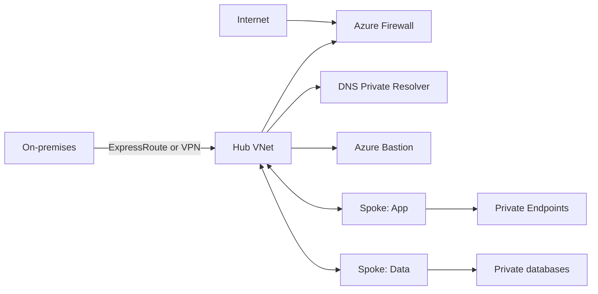

## Architecture


## Design decisions
A hub should host shared connectivity and security services, not every shared application. Use separate subscriptions for connectivity and workloads. VNet peering is non-transitive, so traffic between spokes needs explicit routing through a network virtual appliance, Azure Firewall, or a different topology such as Virtual WAN.

Define IP address management before deployment. Reserve space for growth, private endpoints, AKS and disaster recovery. Avoid overlapping RFC1918 ranges because peering and hybrid routing become difficult later.

## Routing validation
```bash
az network nic show-effective-route-table --resource-group rg-app-prod --name nic-app-01 -o table
az network nic list-effective-nsg --resource-group rg-app-prod --name nic-app-01 -o jsonc
az network watcher test-connectivity --source-resource <vm-id> --dest-address api.internal.contoso.com --dest-port 443
```

## Workarounds
- **Spoke-to-spoke traffic is asymmetric:** make both subnet route tables point to the same inspection path and enable forwarding on the NVA.
- **Private endpoint traffic bypasses intended inspection:** decide whether inspection is technically supported and desirable. Private endpoint traffic may require specific routing and DNS architecture.
- **Forced tunnelling breaks platform access:** document Azure service dependencies, use service tags where appropriate, and validate next-hop behaviour.
- **Peering says connected but traffic fails:** check NSGs, UDRs, appliance forwarding, DNS and guest firewall.

## 2024 attention points
In 2024, many organisations were still mixing classic hub-and-spoke, Virtual WAN and ad-hoc peering. The key was not choosing the newest topology, but making routing ownership, DNS and security inspection explicit.

## Production validation checklist
- [ ] Confirm regional availability, SKU, API version and 2024 feature status against Microsoft documentation.
- [ ] Review current retirement notices before reusing the article after 2024.
- [ ] Test in a non-production subscription and preserve rollback evidence.
- [ ] Validate identity, DNS, network, cost, monitoring, security and recovery dependencies.
- [ ] Replace placeholders and never paste production secrets into source control.
- [ ] Use architecture decision records for material trade-offs.

> **Historical scope:** This article is written with a 2024 architecture lens. It describes real Azure services and engineering patterns, but Azure capabilities evolve. Revalidate all commands, limits, SKUs, API versions and support status before production use.
