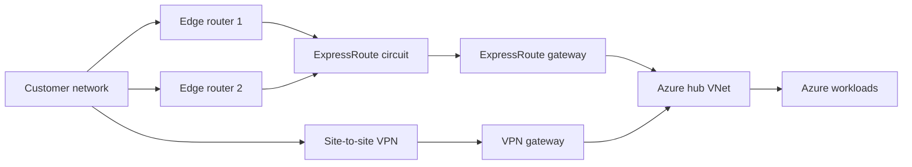

## Architecture


## Objective
ExpressRoute offers private connectivity but does not remove the need for resilient customer edge, provider diversity, gateway redundancy and a tested backup path. VPN failover is useful only if routes, bandwidth, DNS, MTU and security rules are valid during the test.

## BGP checks
```powershell
Get-AzExpressRouteCircuitRouteTable -ResourceGroupName rg-connectivity -ExpressRouteCircuitName er-prod -PeeringType AzurePrivatePeering -DevicePath Primary
Get-AzVirtualNetworkGatewayLearnedRoute -ResourceGroupName rg-connectivity -VirtualNetworkGatewayName vpngw-prod
```

## Test method
1. Capture normal routes and latency.
2. Confirm VPN tunnel established but less preferred.
3. Disable one path under change control.
4. Measure convergence and application impact.
5. Validate return path and throughput.
6. Restore and confirm preferred route returns.

## Workarounds
- **VPN never carries traffic:** BGP or static route preference still favours an unavailable route. Inspect local preference, AS-path and stale routes.
- **Small tests work, large transfers fail:** investigate MTU and fragmentation across IPSec.
- **Failover succeeds but performance collapses:** size VPN bandwidth for minimum business service, not only connectivity.
- **Both links share one physical carrier:** purchase logical diversity only after validating last-mile and provider diversity.

## 2024 attention points
Documenting the intended active path and backup path was critical. An untested VPN tunnel was not a disaster-recovery solution.

## Production validation checklist
- [ ] Confirm regional availability, SKU, API version and 2024 feature status against Microsoft documentation.
- [ ] Review current retirement notices before reusing the article after 2024.
- [ ] Test in a non-production subscription and preserve rollback evidence.
- [ ] Validate identity, DNS, network, cost, monitoring, security and recovery dependencies.
- [ ] Replace placeholders and never paste production secrets into source control.
- [ ] Use architecture decision records for material trade-offs.

> **Historical scope:** This article is written with a 2024 architecture lens. It describes real Azure services and engineering patterns, but Azure capabilities evolve. Revalidate all commands, limits, SKUs, API versions and support status before production use.
