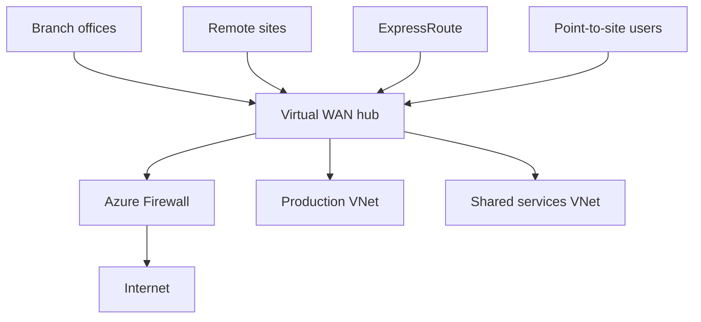

## Architecture


## When it fits
Virtual WAN fits large branch estates, multi-region transit and managed connectivity. It is not automatically cheaper or simpler for a small number of VNets. Compare route control, third-party NVA integration, operational skills and migration complexity against classic hub-and-spoke.

## Routing intent
Define whether private and internet traffic must pass through Azure Firewall or a supported security provider. Validate propagated and associated route tables for every connection.

```bash
az network vhub route-table list --resource-group rg-vwan --vhub-name vhub-weu -o table
az network vhub connection list --resource-group rg-vwan --vhub-name vhub-weu -o jsonc
```

## Workarounds
- **Unexpected direct spoke route:** inspect connection propagation and routing intent, not only UDRs inside spokes.
- **NVA integration is limited:** validate supported insertion pattern before choosing the platform.
- **Migration causes route overlap:** migrate in phases and prevent simultaneous advertisement of conflicting prefixes.
- **Branch learns too many routes:** summarise where safe and apply route control at branch and platform boundaries.

## 2024 attention points
The main risk was assuming Virtual WAN behaved exactly like a customer-managed router. The service abstracts routing, so teams needed to learn its connection and route-table model.

## Production validation checklist
- [ ] Confirm regional availability, SKU, API version and 2024 feature status against Microsoft documentation.
- [ ] Review current retirement notices before reusing the article after 2024.
- [ ] Test in a non-production subscription and preserve rollback evidence.
- [ ] Validate identity, DNS, network, cost, monitoring, security and recovery dependencies.
- [ ] Replace placeholders and never paste production secrets into source control.
- [ ] Use architecture decision records for material trade-offs.

> **Historical scope:** This article is written with a 2024 architecture lens. It describes real Azure services and engineering patterns, but Azure capabilities evolve. Revalidate all commands, limits, SKUs, API versions and support status before production use.
