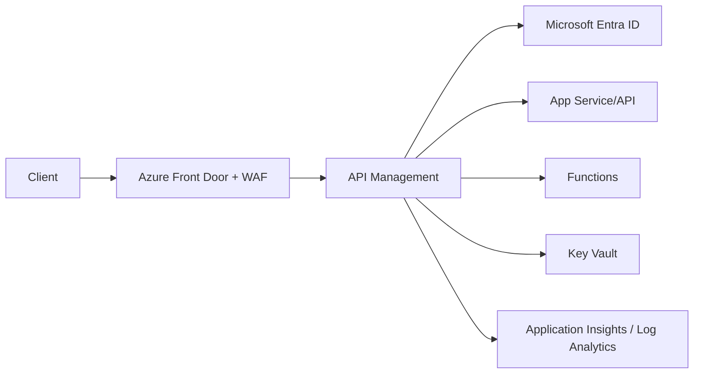

## Architecture


## Separation of concerns
Use Front Door or Application Gateway for edge protection where required, APIM for API lifecycle and policy, and backend services for business logic. Avoid turning APIM policies into a large application language.

## Policy example
```xml
<policies>
  <inbound>
    <base />
    <validate-jwt header-name="Authorization" failed-validation-httpcode="401">
      <openid-config url="https://login.microsoftonline.com/{tenant}/v2.0/.well-known/openid-configuration" />
      <audiences><audience>api://orders</audience></audiences>
    </validate-jwt>
    <rate-limit-by-key calls="100" renewal-period="60" counter-key="@(context.Subscription?.Key ?? context.Request.IpAddress)" />
    <set-header name="x-correlation-id" exists-action="skip">
      <value>@(Guid.NewGuid().ToString())</value>
    </set-header>
  </inbound>
  <backend><base /></backend>
  <outbound><base /></outbound>
  <on-error><base /></on-error>
</policies>
```

## Workarounds
- **Policy works in test but fails in production:** trace policy execution with protected diagnostics and verify named values and certificates.
- **Backend certificate errors:** validate SNI, hostname and certificate chain.
- **Rate limits differ across gateways:** understand counter scope and distributed gateway behaviour.
- **Multi-region failover is incomplete:** replicate configuration, certificates, DNS and backend dependencies, then test client behaviour.

## 2024 attention points
Treat developer portal, gateway runtime, management plane, private networking and observability as separate lifecycle components.

## Production validation checklist
- [ ] Confirm regional availability, SKU, API version and 2024 feature status against Microsoft documentation.
- [ ] Review current retirement notices before reusing the article after 2024.
- [ ] Test in a non-production subscription and preserve rollback evidence.
- [ ] Validate identity, DNS, network, cost, monitoring, security and recovery dependencies.
- [ ] Replace placeholders and never paste production secrets into source control.
- [ ] Use architecture decision records for material trade-offs.

> **Historical scope:** This article is written with a 2024 architecture lens. It describes real Azure services and engineering patterns, but Azure capabilities evolve. Revalidate all commands, limits, SKUs, API versions and support status before production use.
