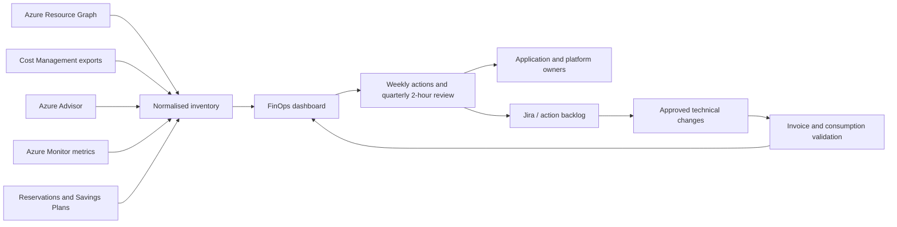

## Executive summary
A global retail organisation was operating a broad Azure estate with a monthly run rate near **€272,000**. The requirement was not a one-off cost-cutting exercise. The objective was to build a repeatable operating model that could identify waste, protect production, improve commitment decisions and connect technical actions to accountable business owners.

The estate analysis exposed significant optimisation signals: **135 of 850 managed disks were not attached to a VM**, representing roughly **26 TB out of 235 TB**; **28 of 150 public IP addresses appeared unused**; **58 of 343 VMs were in a PowerOff state**; and around **90% of VMs had not exceeded 10% CPU over the preceding seven days**. Reservation analysis was equally important: only **21 of 126 reservations were fully used**, while **97 had expired or been cancelled** in the earlier baseline.

A later governance cycle showed the operating model maturing: **76 successful reservations covered 152 production VMs**, eight three-year commitments were below full utilisation, eleven reservations required renewal attention, and twenty-two additional production VMs required a reservation assessment. The monthly Azure trajectory moved from approximately **€272k to €227k**, while an optimisation backlog identified around **€60k per month** in cost-saving opportunities.

The main lesson was simple: cloud cost optimisation becomes credible only when every saving is connected to evidence, an owner, a change record and invoice validation.

## Business problem
The business faced five simultaneous risks:

1. unused technical resources continued to generate cost;
2. commitment discounts were not systematically governed;
3. low utilisation did not automatically mean a resource could be resized;
4. ownership gaps delayed deletion and remediation;
5. monthly cost discussions happened after consumption rather than before architectural decisions.

The initial FinOps model therefore had to combine **Inform, Optimise and Operate** rather than produce another static report.

## Operating architecture


## Baseline inventory
The recurring review included:

- Azure regions and network hops;
- unattached disks and orphaned snapshots;
- storage redundancy and stale data;
- VMs below 10% CPU;
- expired, cancelled and underutilised reservations;
- Azure Hybrid Benefit eligibility;
- unused public IPs;
- PowerOff versus deallocated VMs;
- private endpoints and private DNS zones without confirmed consumers;
- premium disks on dormant workloads;
- AKS autoscaling, Spot suitability and start/stop patterns;
- Log Analytics and Application Insights retention;
- App Service Plan consolidation;
- VPN gateways without meaningful traffic;
- Recovery Services Vault consistency.

## Inventory queries
Unattached disks:
```kusto
Resources
| where type =~ 'microsoft.compute/disks'
| extend state=tostring(properties.diskState)
| where state == 'Unattached'
| project subscriptionId, resourceGroup, name, location,
          sizeGB=toint(properties.diskSizeGB), sku=tostring(sku.name), tags
| order by sizeGB desc
```

Unused public IP candidates:
```kusto
Resources
| where type =~ 'microsoft.network/publicipaddresses'
| where isempty(properties.ipConfiguration)
| project subscriptionId, resourceGroup, name, location,
          allocation=tostring(properties.publicIPAllocationMethod), tags
```

VM inventory:
```powershell
$rows = foreach ($sub in Get-AzSubscription) {
    Set-AzContext -SubscriptionId $sub.Id | Out-Null
    Get-AzVM -Status | ForEach-Object {
        $state = ($_.Statuses | Where-Object Code -like 'PowerState/*').DisplayStatus
        [pscustomobject]@{
            Subscription = $sub.Name
            ResourceGroup = $_.ResourceGroupName
            VM = $_.Name
            Size = $_.HardwareProfile.VmSize
            PowerState = $state
            Application = $_.Tags['Application']
            Owner = $_.Tags['TechnicalOwner']
        }
    }
}
$rows | Export-Csv ./vm-inventory.csv -NoTypeInformation
```

## Why the numbers required interpretation
### 135 unattached disks did not mean 135 immediate deletions
The engineering workflow was:

```text
Discover → identify last attachment → identify owner → confirm backup/recovery dependency
→ apply quarantine tag → wait → delete through change → confirm invoice impact
```

A disk could be intentionally retained for rollback, legal investigation or application recovery. Automatic deletion based only on `Unattached` would have created unacceptable risk.

### 90% below 10% CPU did not mean 90% should be downsized
CPU was only the first signal. Production rightsizing needed:

- 30-day CPU average, P95 and maximum;
- memory headroom;
- disk IOPS and throughput;
- network throughput;
- batch and seasonal peaks;
- licensing constraints;
- application-owner confirmation;
- rollback SKU and maintenance window.

Example CPU query:
```kusto
Perf
| where TimeGenerated > ago(30d)
| where ObjectName == 'Processor' and CounterName == '% Processor Time'
| where InstanceName == '_Total'
| summarize Average=avg(CounterValue), P95=percentile(CounterValue,95), Maximum=max(CounterValue) by Computer
| order by P95 asc
```

## Reservation governance
The reservation process was separated into four controls:

1. **Coverage**: how much eligible baseline usage is discounted?
2. **Utilisation**: how much purchased commitment is consumed?
3. **Expiry**: which reservations require a decision before renewal?
4. **Fit**: does the commitment still match SKU, region and workload lifecycle?

```text
Coverage     = eligible usage receiving benefit / total eligible usage
Utilisation  = consumed reservation quantity / purchased reservation quantity
```

The estate had 174 production VMs in the later review. Reservation analysis already covered 152, leaving 22 for further assessment. Eight three-year commitments required attention because utilisation was below 100%, and eleven renewals needed a formal decision before the renewal window.

Auto-renewal was intentionally not a substitute for governance. Renewing automatically could preserve a commitment after rightsizing, decommissioning or architecture change.

## Financial trajectory
Observed monthly values moved through approximately:

| Observation | Monthly amount |
|---|---:|
| Earlier run rate | €272k |
| July | €233k |
| August | €230k |
| September forecast | €224k |
| Later consolidated level | about €227k |

The movement from €272k to €227k represents roughly **€45k per month**, or **16.5%**. The broader backlog identified around **€60k per month** in potential optimisation, but potential and realised savings were deliberately kept separate.

```text
Potential saving ≠ approved saving ≠ implemented saving ≠ realised invoice reduction
```

## Governance cadence
### Weekly synchronisation
A short weekly session handled expiring commitments, blocked decommissions, owners, cost anomalies and dashboard issues.

### Quarterly deep dive
A two-hour quarterly review produced a prioritised action plan. The review examined architecture, reservations, licensing, unused resources, PaaS tiers, retention and service consolidation.

### Action backlog
About fifty FinOps tickets were tracked in one annual cycle. Thirty-one were primarily infrastructure or decommissioning actions. Twenty-six resources still required tagging analysis before appropriate ownership could be assigned.

## Business value
- reduced monthly cloud run rate;
- prevented avoidable pay-as-you-go exposure at reservation expiry;
- reduced technology debt through decommissioning;
- connected cost to Application and Technical Owner;
- created evidence for financial planning;
- prevented reservation purchases against unoptimised resources;
- exposed high-cost areas such as backup, analytics and data-platform services for architectural review.

## Failure modes and workarounds
- **Dashboard visibility changes break trust:** version the allocation rules and publish data-quality status.
- **Owner refuses deletion:** require a business justification and expiry date for the exception.
- **Low CPU but high memory:** use memory evidence and workload testing before resize.
- **Stopped VM still costs money:** distinguish guest shutdown from Azure deallocation.
- **Reservation renewal is urgent:** create 90-, 60- and 30-day reminders with named owner.
- **Savings claimed too early:** validate against normalised invoice data after implementation.

## Reusable decision checklist
- [ ] Is the resource owner identified?
- [ ] Is the application lifecycle confirmed?
- [ ] Are 30 days of performance metrics available?
- [ ] Is business seasonality represented?
- [ ] Is rollback defined?
- [ ] Does a reservation already cover the resource?
- [ ] Is Azure Hybrid Benefit applicable and evidenced?
- [ ] Is the saving visible after implementation?

## Publication and confidentiality note
This article is based on an enterprise engagement. Customer names, internal identifiers, hostnames, subscription identifiers, commercial contacts and selected architecture details have been removed or normalised. Quantified values are retained only where they are useful to explain the engineering or business decision. Prices remain indicative and must be recalculated before reuse.
