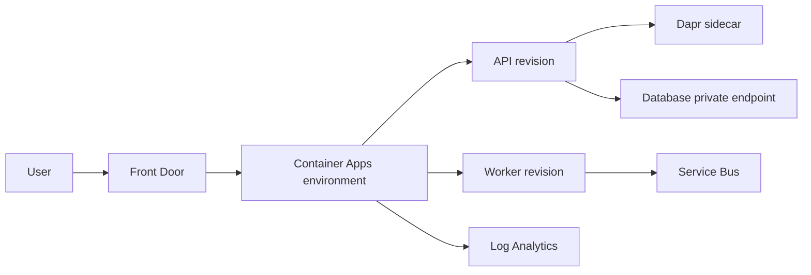

## Architecture


## Revision strategy
Use single revision mode for ordinary replacement and multiple revision mode for traffic splitting or controlled canaries. A revision is immutable, but secrets and scaling configuration require careful lifecycle handling.

```bash
az containerapp revision list --name orders-api --resource-group rg-app -o table
az containerapp ingress traffic set --name orders-api --resource-group rg-app --revision-weight orders-api--blue=90 orders-api--green=10
```

## KEDA scaling
```yaml
scale:
  minReplicas: 1
  maxReplicas: 20
  rules:
    - name: servicebus
      custom:
        type: azure-servicebus
        metadata:
          queueName: orders
          messageCount: "20"
```

## Workarounds
- **Scale-to-zero increases latency:** keep minimum replicas for latency-sensitive APIs.
- **Private environment cannot pull images:** validate DNS, ACR private endpoint and outbound dependencies.
- **Revision receives no traffic:** check labels, ingress target port and revision health.
- **Dapr component secret is exposed:** use managed identity or secret references and restrict component scope.

## 2024 attention points
Container Apps was attractive for teams wanting managed container orchestration without operating Kubernetes. The trade-off was less low-level control than AKS.

## Production validation checklist
- [ ] Confirm regional availability, SKU, API version and 2024 feature status against Microsoft documentation.
- [ ] Review current retirement notices before reusing the article after 2024.
- [ ] Test in a non-production subscription and preserve rollback evidence.
- [ ] Validate identity, DNS, network, cost, monitoring, security and recovery dependencies.
- [ ] Replace placeholders and never paste production secrets into source control.
- [ ] Use architecture decision records for material trade-offs.

> **Historical scope:** This article is written with a 2024 architecture lens. It describes real Azure services and engineering patterns, but Azure capabilities evolve. Revalidate all commands, limits, SKUs, API versions and support status before production use.
