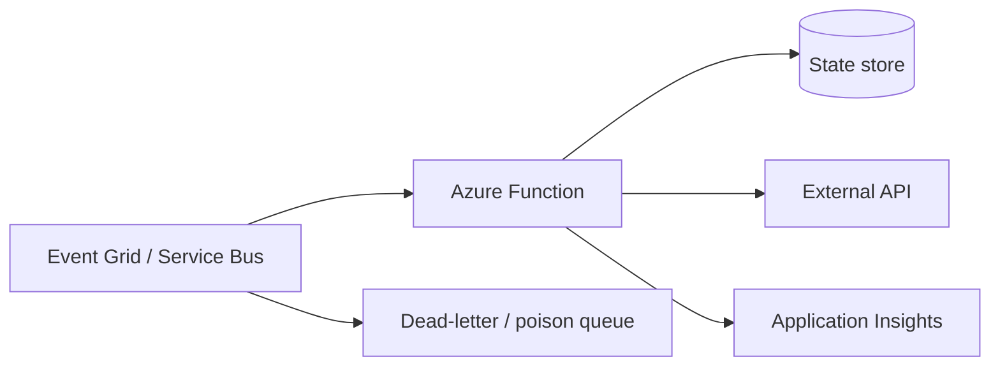

## Architecture


## Idempotency
At-least-once delivery means a function can process the same event more than once. Use an idempotency key and atomic state transition.

```csharp
if (await store.ExistsAsync(message.Id)) return;
await ProcessAsync(message);
await store.MarkCompleteAsync(message.Id);
```

For financial or inventory operations, record intent and result transactionally. Do not rely on a brief in-memory cache.

## Retry pattern
Use bounded exponential backoff with jitter. Distinguish transient faults from permanent validation errors. Dead-letter failures after the defined attempt count.

## Workarounds
- **Function times out:** split long workflows with Durable Functions or asynchronous queues.
- **Duplicate execution:** implement business idempotency, not just host-level duplicate detection.
- **Cold start hurts API latency:** choose an appropriate plan and minimum/prewarmed instances.
- **Storage dependency fails:** every Function app depends on storage for core runtime scenarios; protect and monitor it.
- **Deployment changes configuration unexpectedly:** separate application settings from code deployment and version infrastructure.

## 2024 attention points
Plan choice affected networking, scale, cost, timeout and cold-start behaviour. Teams needed to select from workload characteristics, not cheapest nominal price.

## Production validation checklist
- [ ] Confirm regional availability, SKU, API version and 2024 feature status against Microsoft documentation.
- [ ] Review current retirement notices before reusing the article after 2024.
- [ ] Test in a non-production subscription and preserve rollback evidence.
- [ ] Validate identity, DNS, network, cost, monitoring, security and recovery dependencies.
- [ ] Replace placeholders and never paste production secrets into source control.
- [ ] Use architecture decision records for material trade-offs.

> **Historical scope:** This article is written with a 2024 architecture lens. It describes real Azure services and engineering patterns, but Azure capabilities evolve. Revalidate all commands, limits, SKUs, API versions and support status before production use.
