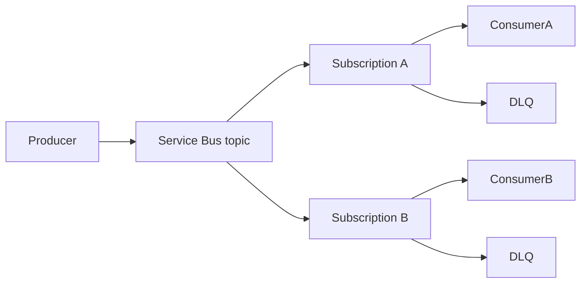

## Architecture


## Delivery semantics
Service Bus provides durable messaging, but application designs should assume at-least-once delivery. Use duplicate detection and application-level idempotency. Sessions provide ordered processing for related messages when the same session ID is used.

## Dead-letter operations
```bash
az servicebus queue show --resource-group rg-int --namespace-name sb-prod --name orders --query countDetails
```

Build a controlled DLQ replay process that validates message age, schema and downstream readiness. Replaying every message blindly can recreate an incident.

## Workarounds
- **Lock lost errors:** shorten processing, renew locks automatically or use competing staged workers.
- **DLQ grows silently:** alert on dead-letter count and oldest message age.
- **Duplicate detection window is insufficient:** retain application idempotency for the business retention period.
- **Geo-disaster recovery expected to replicate messages:** namespace metadata aliasing and data replication are different capabilities; validate the selected feature and tier.

## 2024 attention points
Premium tier was often required for predictable performance, private networking and enterprise throughput. Partitioning and sessions needed early design, not late tuning.

## Production validation checklist
- [ ] Confirm regional availability, SKU, API version and 2024 feature status against Microsoft documentation.
- [ ] Review current retirement notices before reusing the article after 2024.
- [ ] Test in a non-production subscription and preserve rollback evidence.
- [ ] Validate identity, DNS, network, cost, monitoring, security and recovery dependencies.
- [ ] Replace placeholders and never paste production secrets into source control.
- [ ] Use architecture decision records for material trade-offs.

> **Historical scope:** This article is written with a 2024 architecture lens. It describes real Azure services and engineering patterns, but Azure capabilities evolve. Revalidate all commands, limits, SKUs, API versions and support status before production use.
