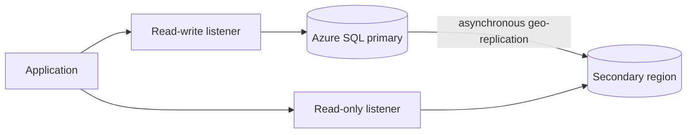

## Architecture


## Availability layers
Built-in local high availability is not the same as zonal resilience or regional disaster recovery. Select business-critical, zone redundancy, active geo-replication or failover groups according to RTO, RPO and cost.

## Client connection resiliency
```csharp
var options = new SqlRetryLogicOption
{
    NumberOfTries = 5,
    DeltaTime = TimeSpan.FromSeconds(2),
    MaxTimeInterval = TimeSpan.FromSeconds(30)
};
```

Use the stable failover group listener where applicable. Implement retry for transient errors, but keep transactions bounded and idempotent.

## Workarounds
- **Failover works but app does not reconnect:** verify DNS caching, client-driver version, connection pooling and retry policy.
- **Read scale returns stale data:** understand replication lag and route only suitable queries.
- **Private endpoints fail after regional event:** design DNS and regional private endpoints explicitly.
- **Long transaction rollback dominates RTO:** reduce transaction scope and rehearse failover under realistic load.

## 2024 attention points
A portal checkbox did not prove application recovery. End-to-end testing needed client drivers, DNS, identity, firewall, jobs and dependent databases.

## Production validation checklist
- [ ] Confirm regional availability, SKU, API version and 2024 feature status against Microsoft documentation.
- [ ] Review current retirement notices before reusing the article after 2024.
- [ ] Test in a non-production subscription and preserve rollback evidence.
- [ ] Validate identity, DNS, network, cost, monitoring, security and recovery dependencies.
- [ ] Replace placeholders and never paste production secrets into source control.
- [ ] Use architecture decision records for material trade-offs.

> **Historical scope:** This article is written with a 2024 architecture lens. It describes real Azure services and engineering patterns, but Azure capabilities evolve. Revalidate all commands, limits, SKUs, API versions and support status before production use.
