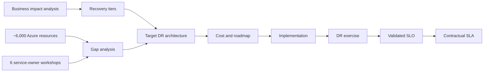
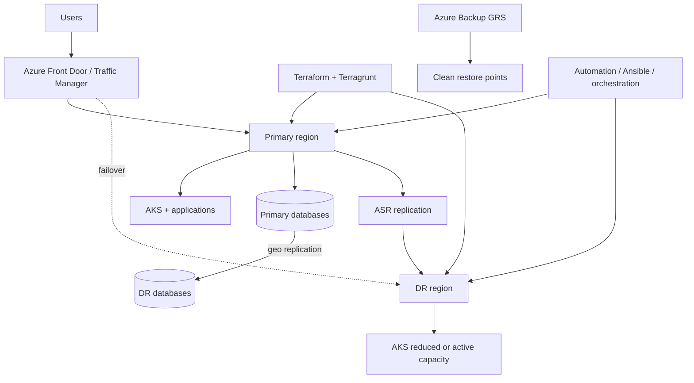

## Executive summary
A global retail organisation depended on physical and digital sales channels representing more than **€620 million in annual revenue exposure**. The Azure estate contained roughly **30 subscriptions in the primary tenant**, another reachable secondary-tenant subscription, approximately **6,000 Azure resources**, **124 virtual networks**, **276 peerings**, **six VPN gateways**, **two ExpressRoute circuits**, **248 remote-site network definitions** and **64 Standard Load Balancers**.

The business had defined mission-critical services with RTO below one hour, operationally critical services with four-hour RTO and support services with 24-hour RTO. Yet backup, replication, Infrastructure as Code, application dependencies and failover orchestration were uneven. A separate application review catalogued around **70 applications**, with about **50 in DR scope**.

The solution was not “turn on Azure Site Recovery everywhere.” It used different recovery tiers, continuous replication where justified, Terraform/Terragrunt for reproducibility, Azure Backup GRS for clean recovery points, traffic orchestration and sequenced runbooks. The estimated Azure infrastructure run cost for the assessed Layer 0 and Layer 0.5 foundation was approximately **€9,112.83 per month**, excluding future scope and third-party licences.

## Why backup was not enough
Around **300 Azure VMs** had backup policies and the backup storage used geo-redundant storage. This protected recovery points, but GRS replication did not give the customer direct control of a platform-managed storage failover. Therefore, a two-hour RTO could not be assumed from GRS backup alone.

```text
Backup answers: can clean data be restored?
DR answers: can the service be recovered within the business objective?
```

## Scope and methodology
The assessment ran for six weeks and combined read-only discovery with six service-owner workshops covering identity and PKI, Citrix/PAM/orchestration, DNS and monitoring, firewalls and VPN, AKS, SQL and integration platforms.



## Layering model
```text
Layer 0   : Network, identity, DNS, security, monitoring, PKI, Azure foundations
Layer 0.5 : AKS, integration, PAM, orchestration, database and virtual desktop platforms
Layer 1A  : Business applications
Layer 1B  : External applications and dependencies
```

No Layer 1 application could be recovered credibly before Layer 0 and 0.5 were functioning.

## Observed architecture risks
### Network concentration
The main hub carried **123 of 276 peering relationships**. Twenty-two peerings were disconnected and one remained initiated. Five of six VPN gateways were concentrated in one European region, and both ExpressRoute circuits were anchored to the same broad European dependency zone. This did not mean every link was wrong, but it showed the recovery region could not be treated as an isolated application landing zone.

### Identity asymmetry
Twelve identity-related VMs were distributed across European and US regions, but federation, Web Application Proxy, synchronisation and NPS were concentrated in Europe. Password Hash Synchronisation improved cloud-authentication resilience, yet federation and synchronisation still needed explicit recovery decisions.

### PKI
Two PKI servers had no high availability or replication, certificate lifecycle was manual, expiration alerting was absent and CRL availability had a broader blast radius including store connectivity.

### Infrastructure as Code
No complete IaC baseline existed. Live resource configuration therefore had to be enumerated and reverse-engineered before a reproducible DR environment could be built.

## Application-tier gap
The application analysis identified:

- three Active-Active candidates;
- eight Warm Standby applications;
- nine Pilot Light applications;
- one Backup and Restore pattern;
- multiple vendor-managed SaaS dependencies;
- infrastructure enablers not fully represented in the BIA.

Current achievable recovery diverged materially from business expectations. Warm Standby candidates with two-hour to one-day declared RTOs were realistically in a **12–24 hour** position under daily, single-region protection. Pilot Light candidates were realistically **two to four days** without ASR and scripted recovery.

## Target architecture


### Defence in depth for recovery
1. continuous replication for regional failure;
2. IaC to reproduce infrastructure and control drift;
3. independent backup points in case replicated corruption crosses regions;
4. Front Door or Traffic Manager for traffic switching;
5. runbook automation for strict dependency sequencing.

## Recovery tiers
| Tier | Target RPO | Target RTO | Pattern |
|---|---:|---:|---|
| Active-Active | <1 min | <5 min | both regions serving traffic |
| Warm Standby | <15 min | 30–60 min | reduced-capacity DR, automated failover |
| Pilot Light | <30 min | 2–4 h | core capacity plus scripted scale-up |
| Backup & Restore | <4 h | <24 h | no standing application environment |
| Vendor BCP | contractual | contractual | audit provider commitment |

These values were target SLOs, not promises. The governance principle was explicit: **a recovery objective becomes a contractual SLA only after a realistic drill demonstrates it**.

## IaC reconnaissance
The immediate precondition was a three-to-five-week IaC reconnaissance stream.

```bash
az graph query -q "Resources | project subscriptionId, resourceGroup, name, type, location, tags" --first 5000 -o json > inventory.json
```

A practical Terraform import target was:

```text
terraform plan → zero unintended changes against live production
```

Separate state per region and Terragrunt orchestration avoided coupling every region into one state file. ASR handled VM state replication; Terraform defined infrastructure. The technologies were complementary.

## Cost model
The assessed Layer 0 and Layer 0.5 DR infrastructure estimate was:

| Foundation scope | Monthly estimate |
|---|---:|
| Layer 0, European DR target | €3,662.50 |
| Layer 0, US DR target | €2,576.51 |
| Layer 0.5, European DR target | €1,810.47 |
| Layer 0.5, US DR target | €1,063.35 |
| **Total** | **€9,112.83** |

This estimate excluded consumption variation, pricing changes, third-party licences and later scope growth. The useful business comparison was not “€9.1k versus zero.” It was €9.1k versus outage exposure, reputation, manual recovery uncertainty and the cost of missing recovery objectives.

## Critical dependency logic
A batch orchestration platform initially had a one-day business RTO but was required to restore multiple Warm Standby applications. If it recovered after four hours, a 30–60 minute application objective was mathematically impossible. The service therefore had to be promoted into the earlier recovery sequence.

The same logic applied to virtual desktop access: recovering an application did not create business service if remote teams could not access it.

## Test strategy
```text
Technical component test
→ Layer 0 integrated test
→ Layer 0.5 sequence test
→ application smoke test
→ business process validation
→ failback and evidence review
```

Metrics:

- declaration-to-start time;
- infrastructure recovery time;
- data recovery point;
- application validation time;
- manual interventions;
- failed automation steps;
- failback duration;
- business sign-off.

## Workarounds and attention points
- If a DR database engine is unknown, verify before designing replication.
- If Velero or equivalent application-state protection is not enabled for critical AKS workloads, treat as immediate gap.
- If vendor SLA allows more downtime than the business RTO, resolve the commercial contradiction.
- If a dependency is missing from BIA, add it before committing an application SLO.
- If no IaC exists, start import and drift discovery before building DR manually.
- If secondary-region quota exists but capacity is uncertain, define alternate SKUs and test deployment.

## Business value
The assessment converted resilience from a generic requirement to a funded, sequenced and measurable programme. It showed management which investments closed material revenue exposure, which RTOs were technically credible and which promises required evidence before contract.

## Publication and confidentiality note
This article is based on an enterprise engagement. Customer names, internal identifiers, hostnames, subscription identifiers, commercial contacts and selected architecture details have been removed or normalised. Quantified values are retained only where they are useful to explain the engineering or business decision. Prices remain indicative and must be recalculated before reuse.
