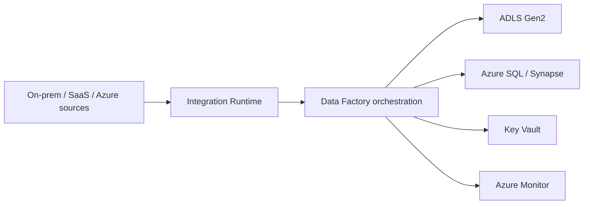

## Architecture

## Runtime choices
Use Azure IR for cloud movement, self-hosted IR for private or on-premises access, and managed virtual network where service-managed isolation fits. Deploy self-hosted IR in a resilient pair and test upgrade and failover.

## CI/CD
Promote factory code through environments with parameters. Avoid authoring directly in production. Separate global parameters, linked-service secrets and environment-specific endpoints.

## Workarounds
- **Self-hosted IR is online but pipeline fails:** validate DNS, proxy, certificate trust and source-driver versions.
- **Triggers fire during deployment:** stop triggers before deployment and restart only intended triggers afterward.
- **Rerun duplicates data:** build watermarking or idempotent sink behaviour.
- **Copy activity is slow:** analyse DIUs, source throttling, partitioning and network path before increasing parallel copies.
- **Secret rotation breaks linked service:** use Key Vault references and test rotation with overlapping validity.

## 2024 attention points
Teams increasingly separated orchestration from transformation and avoided putting heavy business transformation into pipeline expressions.

## Production validation checklist
- [ ] Confirm regional availability, SKU, API version and 2024 feature status against Microsoft documentation.
- [ ] Review current retirement notices before reusing the article after 2024.
- [ ] Test in a non-production subscription and preserve rollback evidence.
- [ ] Validate identity, DNS, network, cost, monitoring, security and recovery dependencies.
- [ ] Replace placeholders and never paste production secrets into source control.
- [ ] Use architecture decision records for material trade-offs.

> **Historical scope:** This article is written with a 2024 architecture lens. It describes real Azure services and engineering patterns, but Azure capabilities evolve. Revalidate all commands, limits, SKUs, API versions and support status before production use.
