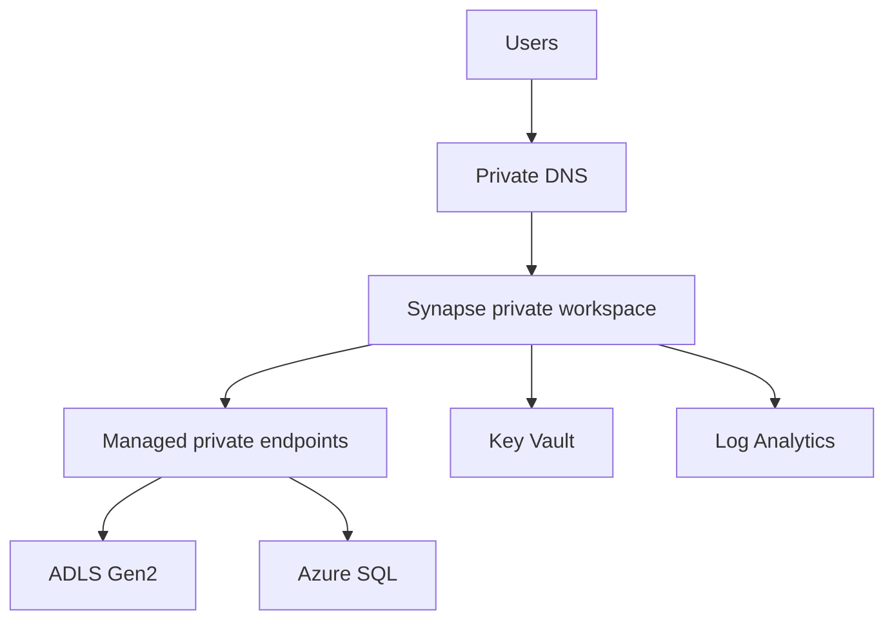

## Architecture

## Security model
Control workspace access, SQL/Spark permissions, storage-plane access and network reachability separately. Managed private endpoints need approval on destination resources. Managed identity rights must be assigned at the data resource.

## Workarounds
- **Private endpoint exists but query cannot read storage:** verify storage RBAC/ACLs and managed private endpoint approval.
- **User can enter workspace but not query:** workspace role does not automatically grant data permissions.
- **Pipeline works in test only:** compare linked services, identity, DNS and firewall configuration by environment.
- **Data exfiltration protection blocks legitimate target:** add only approved managed private endpoints and document destination ownership.

## 2024 attention points
The design needed to account for the coexistence of serverless SQL, dedicated SQL, Spark and pipelines, each with different scaling and security characteristics.

## Production validation checklist
- [ ] Confirm regional availability, SKU, API version and 2024 feature status against Microsoft documentation.
- [ ] Review current retirement notices before reusing the article after 2024.
- [ ] Test in a non-production subscription and preserve rollback evidence.
- [ ] Validate identity, DNS, network, cost, monitoring, security and recovery dependencies.
- [ ] Replace placeholders and never paste production secrets into source control.
- [ ] Use architecture decision records for material trade-offs.

> **Historical scope:** This article is written with a 2024 architecture lens. It describes real Azure services and engineering patterns, but Azure capabilities evolve. Revalidate all commands, limits, SKUs, API versions and support status before production use.
