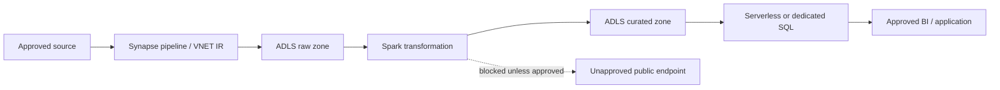

> **Updated 13 November 2026.** Several Synapse network and workspace controls are creation-time decisions. Confirm current feature compatibility and limitations before creating a workspace intended for sensitive data.

Azure Synapse Analytics can combine data integration, Spark, serverless SQL, dedicated SQL pools, and shared workspace artifacts. That breadth makes the workspace a security boundary with several distinct access paths. A user may be able to open Synapse Studio but not read data; a pipeline identity may access a storage account while an analyst cannot; a Spark pool may use a managed private endpoint while a SQL pool follows a different network path. A secure design must distinguish the workspace control plane, the development surface, compute execution, data-plane authorization, and network egress.

The most consequential design choice is often made before a workspace exists: whether to associate a managed virtual network and enable data exfiltration protection. Microsoft documents that the managed virtual network and data exfiltration configuration cannot be changed after workspace creation. Treat the decision as an architecture review, not a checkbox to discover during deployment. This guide presents a layered model based on current [Synapse managed network](https://learn.microsoft.com/azure/synapse-analytics/security/synapse-workspace-managed-vnet), [data exfiltration protection](https://learn.microsoft.com/azure/synapse-analytics/security/workspace-data-exfiltration-protection), and [Synapse RBAC](https://learn.microsoft.com/azure/synapse-analytics/security/synapse-workspace-synapse-rbac) guidance.

## 1. Define the security boundary

Start by documenting the data classes and trust boundaries in the analytics platform:

- Which storage accounts contain raw, curated, restricted, or public data?
- Which users can create notebooks, pipelines, linked services, or SQL scripts?
- Which identities can execute code, access credentials, and read or export data?
- Which external data sources are approved for ingestion?
- Which destinations are approved for outputs and extracts?
- Which network paths are allowed from each compute type?
- Who can approve a new private endpoint or cross-tenant connection?

A useful threat model includes an over-privileged developer, a compromised pipeline credential, an accidentally public storage endpoint, malicious notebook code, data copied to an unapproved tenant, a leaked SAS token, and an exfiltration path through an unrestricted runtime. Also consider accidental disclosure through logs, notebook outputs, query results, temporary files, and artifacts committed to Git.

Do not describe the entire workspace as “private” without stating which traffic is private. In Synapse, inbound access to the workspace, outbound access from Spark and integration runtimes, access from SQL pools to storage, and access by users through Synapse Studio are separate concerns. A managed virtual network mainly governs selected workspace compute and outbound connectivity. Workspace public network settings and private endpoints govern user and client connectivity. SQL permissions and storage permissions govern data access. One setting does not replace the others.

## 2. Choose managed network and exfiltration settings before creation

A Synapse managed workspace virtual network (VNet) is created and operated by Synapse. It isolates eligible workspace integration and Spark resources and supports managed private endpoints to specific Azure resources. It avoids requiring the customer to size and operate a subnet for Spark clusters and allows network isolation between workspaces.

A workspace can additionally enable data exfiltration protection (DEP), which limits eligible outbound communication to approved targets through managed private endpoints. The workspace owner controls the approved Microsoft Entra tenants, while users with the necessary workspace permissions can request managed private endpoint connections to resources in those tenants. The target resource owner must approve the pending connection. This approval model gives both the Synapse team and the data-service owner a role in authorizing the path.

The two settings are not interchangeable:

| Control | Main purpose | Scope and caveat |
|---|---|---|
| Workspace firewall / public network access | Controls inbound access to Synapse workspace endpoints | Does not by itself restrict the workspace's outbound access to data sources |
| Managed workspace VNet | Isolates eligible Spark and integration runtime resources and enables managed private endpoints | Dedicated and serverless SQL pools are multitenant services and do not run inside this managed VNet |
| Managed private endpoint | Creates a private link from eligible managed compute to one approved resource | Connection begins pending and requires approval from the target resource owner |
| Data exfiltration protection | Restricts eligible outbound data paths to approved targets | Creation-time design decision; it does not control ingress and has workload-specific limitations |
| Storage firewall and authorization | Limits who can reach and read/write data | Must align with the runtime network path and the executing identity |

A DEP-enabled workspace blocks some export paths until an approved managed private endpoint exists. For example, writing query results or data to an external storage account may fail until that account is approved and connected. DEP is not simply a universal “private network” flag: Synapse SQL pools are multitenant services outside the managed VNet, and their behavior and supported access paths must be reviewed for each operation. The [DEP documentation](https://learn.microsoft.com/azure/synapse-analytics/security/workspace-data-exfiltration-protection) details those boundaries.

Some integrations are incompatible with DEP or have additional constraints. The current documentation identifies limitations such as certain Event Hub to Data Explorer pool ingestion scenarios and public repository access for Python packages. Some deployment paths may still reference a public Azure Integration Runtime in a DEP-enabled workspace; review pipeline and linked-service references and use the managed VNet runtime where required by the documented security model. Do not enable DEP as a default without checking every data connector, package source, notebook dependency, webhook, and output destination the workload needs. See the [workspace creation and known limitations guide](https://learn.microsoft.com/azure/synapse-analytics/security/how-to-create-a-workspace-with-data-exfiltration-protection).

### Decision questions for the architecture review

Before selecting DEP, answer:

1. Does the workspace need to connect to all its data sources through private links?
2. Which tenant contains each storage account, database, event source, package repository, and output target?
3. Can the target owner approve private endpoint connections within the required change window?
4. Do notebooks need public package feeds or public APIs?
5. Do all pipeline activities support the managed VNet Integration Runtime?
6. Are SQL operations compatible with the intended data-egress controls?
7. How will break-glass diagnostics work if a public path is disabled?
8. Can the organization recreate and migrate the workspace if its creation-time decision proves unsuitable?

Record the answers in an architecture decision record. Since the workspace network and DEP settings cannot be changed after creation, an incorrect assumption can force a new workspace and data/artifact migration.

## 3. Use private endpoints for inbound access deliberately

A workspace managed VNet protects selected outbound traffic from Synapse compute. It does not, by itself, make Synapse Studio or workspace endpoints inaccessible from the public internet. Inbound access is managed with workspace network settings, firewall rules, and private endpoint connectivity. If the organization requires private client connectivity, design the client network, DNS, and endpoint approval before enabling the restriction.

Test access from the actual operator locations: developer workstations, self-hosted build agents, managed DevOps agents, jump hosts, and support networks. Confirm DNS resolves the expected private endpoint from each location and that public paths are blocked where intended. A private endpoint that exists in the portal but is not resolvable from a user's network is not a usable private design.

Create separate endpoint paths for the workspace control surface and data services when required. A private endpoint to the Synapse workspace is not a private endpoint to every storage account used by pipelines. Conversely, a managed private endpoint from a Synapse managed VNet to storage is an outbound data path; it does not let an analyst's laptop connect to Synapse Studio privately.

Establish a controlled process for approving private endpoint connection requests. The requester should identify the linked service, resource, environment, data classification, and purpose. The target owner should validate that the source workspace and tenant are expected. Periodically review approved endpoints for stale workspaces, deleted resources, and undocumented data flows.

## 4. Separate Azure, Synapse, SQL, and storage permissions

Synapse access is layered. Granting one role should not be assumed to grant every other permission.

### Azure RBAC

Azure RBAC governs management-plane actions on the workspace resource and associated Azure resources: who can create or delete a workspace, configure networking, manage resource properties, or assign Azure roles. Keep resource-management roles limited to platform administrators. Analysts generally should not receive Contributor or Owner over the workspace subscription merely because they need to query data.

### Synapse RBAC

Synapse RBAC governs workspace artifacts and operations such as publishing artifacts, running Spark jobs, executing pipelines, monitoring activity, and accessing linked services protected by credentials. Use role definitions aligned to job function. A developer who can publish code does not automatically need permission to retrieve every linked-service secret. An operator who needs run status may not need notebook source or output access.

Microsoft notes that Synapse RBAC provides only limited access control to SQL pools; access to SQL pools is primarily governed by SQL security. Do not mistake workspace-level artifact roles for data-level authorization.

### SQL authorization

Use Microsoft Entra authentication for interactive users and supported managed identities for automation. Assign database roles and object permissions according to the data domain and query requirement. Separate ability to administer a SQL pool from ability to read curated tables. For serverless SQL, remember that reading external data requires both SQL-side permission and authorization to the underlying storage, depending on the credential and authentication path.

### Storage authorization

Data Lake Storage Gen2 access can depend on Azure RBAC and filesystem ACLs. The identity used by Spark, a pipeline, or a linked service must have the required data-plane permissions at the appropriate scope. Test both read and write paths with the actual execution identity. A successful test as a workspace administrator does not prove that a least-privilege pipeline identity will work.

Create a role matrix:

| Persona | Synapse workspace | Compute | SQL | Storage | Credential access |
|---|---|---|---|---|---|
| Data engineer | Develop and publish in owned workspace | Submit jobs to approved pools | Limited schema write where required | Read raw, write assigned curated zone | Use approved linked services, no broad secret retrieval |
| Analyst | Read published artifacts or use SQL endpoint | No Spark administration by default | Read approved views/tables | Direct storage only if explicitly required | No credential-management rights |
| Platform operator | Manage runtime and monitor jobs | Operate pools and integration runtimes | No business-data read unless needed | No broad data access | Manage connection lifecycle under controlled role |
| Security auditor | Review configuration and logs | Read-only operational view | No default data access | Read security evidence as required | No secret values |
| Deployment identity | Publish approved artifacts | Deploy configuration | No interactive query access | Minimal read/write for deployment | Federated or managed identity preferred |

The exact built-in role names and scopes should be verified against the current [Synapse RBAC roles reference](https://learn.microsoft.com/azure/synapse-analytics/security/synapse-workspace-synapse-rbac-roles). Avoid assigning broad workspace administrator permissions to service identities because deployment pipelines need to publish only a subset of artifacts.

## 5. Prefer managed identities and protect secrets

Synapse workspaces require a system-assigned managed identity, and user-assigned managed identities can also be associated for supported scenarios. Managed identities allow the service to obtain Microsoft Entra tokens without storing a client secret in a notebook or pipeline. They can be used for supported linked services, Key Vault access, storage, and other connectors. The [Synapse service identity documentation](https://learn.microsoft.com/azure/synapse-analytics/synapse-service-identity) lists supported uses and the identity lifecycle model.

Use the identity with the smallest data scope required. If a pipeline loads one container, grant that identity access to the relevant storage path rather than the entire data lake. For multi-tenant or multi-environment patterns, consider separate identities to make revocation, audit, and privilege boundaries clearer.

Store unavoidable credentials in Azure Key Vault and reference them through a linked service. Restrict who can create or edit linked services and who can use their credentials. A principal that can run arbitrary notebook code with access to a credential may be able to use that credential indirectly even if it cannot retrieve the secret value. Test the full execution path and understand the privilege implication of `use credential` permissions.

Avoid SAS tokens in notebook source, pipeline parameters, job output, or Git. If SAS is required for a specific integration, define its scope, permissions, expiration, rotation, and monitoring. Use a managed identity or federated identity where supported, and never print tokens or secret-bearing connection strings in logs.

## 6. Govern egress and data movement

Map data movement as explicit edges:

For every edge, identify the initiating runtime, network path, target resource, identity, data class, and approval. A managed private endpoint should be specific to the target resource rather than treated as general connectivity to an entire cloud service. Review what destinations can be reached through linked services, notebook code, pipeline activities, and SQL external data functions.

DEP controls egress to approved targets, but it does not control ingress. It also does not replace data classification, authorization, or monitoring. A target may be approved for private connectivity while the identity still has excessive permissions. A user may be allowed to run code that exports data to a target that is technically approved but not business-approved. Pair network allowlisting with least-privilege identity and activity monitoring.

Use separate storage accounts or containers for raw, curated, restricted, and export data when that makes access control and lifecycle policy clearer. Avoid using a single highly privileged workspace identity for every stage. For sensitive output, require explicit destination approval and apply encryption, classification, retention, and audit controls.

## 7. Secure development, Git, and deployment

Synapse Studio supports collaborative development and deployment workflows. Use Git integration for development branches and publish controlled artifacts into the live workspace through an approved pipeline. Separate authoring permissions from production publishing rights. A pull request should review SQL scripts, pipelines, notebooks, linked services, Spark configuration, and network changes as part of one change set.

Never commit secrets or production data samples. Use secret scanning and repository access controls. Treat notebooks as executable code: a notebook can read data, invoke network-connected libraries, and write outputs. Require code review for changes to data destinations, linked-service references, package installation, or identity use.

Use environment-specific parameters for workspace names, storage endpoints, Key Vault references, and integration runtimes. Avoid promoting a development artifact that retains a development linked service or public endpoint. Validate the rendered deployment parameters and post-deployment references. Use a deployment identity with limited scope and federated credentials where supported; rotate and monitor any remaining credentials.

Keep the live workspace from becoming an untracked editing surface. Restrict direct production edits and reconcile emergency fixes back into source control. Record the deployed commit or release identifier so an incident responder can identify which code, pipeline, and configuration version ran.

## 8. Protect SQL, Spark, and pipeline execution

### SQL pools

Secure dedicated and serverless SQL endpoints with Microsoft Entra identity, SQL permissions, network controls, and auditing. Separate administrative logins from analyst and application identities. Avoid broad grants such as `db_owner` for routine query access. Review external data credentials and storage permissions, because SQL access to an external file may expose a larger dataset than the curated SQL object suggests.

For dedicated SQL pools, review encryption state, auditing, database-level access, and service recovery requirements. If customer-managed keys are required, understand workspace activation, Key Vault permissions, key rotation, and the effect of key unavailability. Microsoft's [Synapse encryption guide](https://learn.microsoft.com/azure/synapse-analytics/security/workspaces-encryption) explains the customer-managed key model and its operational prerequisites.

### Spark pools

Spark jobs execute code on managed compute and can read data using the configured identity and linked services. Restrict who can create pools, attach libraries, run arbitrary notebooks, or view outputs. Govern package sources. In DEP-enabled workspaces, public package repositories such as PyPI can be blocked; use approved workspace packages or a private package channel as documented. Pin and scan dependencies, and retain the lock or environment definition used by production jobs.

Treat notebook outputs as data. Disable or limit display of sensitive records, avoid printing raw rows into execution logs, and apply appropriate workspace permissions to job output. Clean temporary data and checkpoints according to the data classification and retention model.

### Pipelines and integration runtimes

A pipeline can move data across trust boundaries. Use named linked services and managed identities, and limit who can modify their endpoints. For DEP-enabled workspaces, verify that activities use the managed VNet Integration Runtime where the security model requires it. Review any references to public Azure Integration Runtime and warnings in Synapse Studio. Test connectivity through the runtime that will actually run in production, not through a developer laptop.

## 9. Auditing, monitoring, and incident response

Enable diagnostic settings for relevant workspace and SQL activity logs, and route them to a controlled destination with defined retention. Monitor administrative changes, role assignments, private endpoint approvals, firewall updates, pipeline executions, Spark jobs, SQL activity, and data export operations. Keep a record of who deployed each production artifact and what identity executed it.

For SQL auditing, verify the authentication and destination configuration. Current Synapse documentation describes system-assigned managed identity behavior for auditing to storage accounts behind a virtual network or firewall; test the exact destination and permission model. See [Synapse auditing with managed identity](https://learn.microsoft.com/azure/synapse-analytics/sql/auditing-managed-identity).

Build detections for unusual behavior, not only configuration drift:

- a new managed private endpoint to an unfamiliar tenant or resource;
- a pipeline that writes to a new storage account;
- a sudden increase in data egress or export volume;
- role assignments that grant broad data access;
- a notebook or linked service edited outside the deployment pipeline;
- access to a sensitive data zone by an unexpected identity;
- a burst of failed authentication or repeated secret retrieval.

Agree an incident playbook that can revoke an identity, disable a linked service, suspend a pipeline, block a network path, preserve logs, and restore business operations. Test these actions in a non-production environment. The response process should distinguish between stopping a workload and preserving evidence.

## 10. Common design and troubleshooting failures

| Symptom | Likely cause | What to verify |
|---|---|---|
| Spark cannot reach storage | Managed private endpoint missing or unapproved; identity lacks data permission | Endpoint approval state, DNS/path, managed identity role and ACL |
| Pipeline succeeds in dev but fails in DEP production | Different Integration Runtime or public endpoint reference | Linked service, IR selection, endpoint allowlist, package dependency |
| Analyst can open Studio but cannot query data | Workspace access does not grant SQL or storage permissions | Synapse role, SQL grant, storage RBAC/ACL, execution identity |
| SQL can read but export is blocked | DEP restricts outbound target | Approved tenant, managed private endpoint, supported SQL operation |
| Private endpoint exists but client cannot connect | DNS, routing, or workspace public access configuration | Client resolver, private zone links, firewall and endpoint approval |
| Workspace identity cannot read Key Vault | Missing identity permission, firewall, or activation prerequisite | Correct identity, Key Vault role/access policy, network path, workspace state |
| New feature requires public package feed | DEP blocks public egress | Approved private package channel or compatible workspace design |
| Unexpected broad data access | Over-scoped identity or shared credential | Linked-service permissions, identity grants, storage ACLs, notebook execution rights |
| A security setting cannot be changed | Creation-time managed network or DEP choice | Workspace configuration and migration plan; these settings are immutable |
| SQL audit records stop arriving | Destination permissions or identity/network configuration changed | SMI role, firewall, storage path, diagnostic status, retention policy |

Do not solve a connectivity failure by broadly enabling public network access or granting Contributor to the workspace identity. Identify which layer failed: DNS, private endpoint approval, routing, service firewall, identity authentication, data authorization, or runtime support. Correct the narrow failing dependency and repeat the test using the production execution identity.

## 11. A phased secure deployment plan

**Design:** classify data, map identities and data flows, decide managed VNet/DEP, identify integrations and runtime needs, define public/private access requirements, and record creation-time decisions.

**Foundation:** create the workspace through infrastructure as code, configure identity and networking, establish Key Vault and storage permissions, apply diagnostic settings, and assign the initial administrator group.

**Connectivity pilot:** create only the required managed private endpoints, validate target-owner approval, test the Integration Runtime and Spark paths, and verify SQL-specific data access separately.

**Access pilot:** create persona groups, assign Synapse roles, SQL permissions, and storage roles/ACLs. Test with least-privilege user and workload identities. Confirm that an analyst cannot accidentally inherit engineering or secret-management permissions.

**Development workflow:** connect Git, configure branch policy and secret scanning, deploy to a test workspace, parameterize environment-specific endpoints, and restrict production publishing to the deployment identity.

**Security validation:** attempt the expected negative paths: unapproved tenant, unapproved storage account, public package repository, unauthorized SQL table, and an identity without linked-service credential access. Confirm blocked attempts are logged.

**Production rollout:** deploy a representative data product, validate performance and auditing, verify that all required flows work under the chosen network model, and test the incident playbook before onboarding sensitive datasets.

## Production checklist

- [ ] Workspace creation-time network and DEP decisions have an approved design record.
- [ ] Inbound access restrictions are separate from outbound managed VNet controls.
- [ ] Every managed private endpoint maps to a documented target, purpose, owner, and approval.
- [ ] Azure RBAC, Synapse RBAC, SQL permissions, and storage ACLs are reviewed independently.
- [ ] Workload identities have least privilege and secrets are not stored in code or logs.
- [ ] Pipeline and Spark execution use the intended runtime and approved package sources.
- [ ] SQL and storage data paths are tested with the production execution identity.
- [ ] Git, code review, secret scanning, and controlled production publishing are enabled.
- [ ] Diagnostic data covers role changes, endpoint approvals, jobs, SQL activity, and exports.
- [ ] DEP limitations and unsupported integrations are documented and tested.
- [ ] A restore, credential revocation, and incident containment process has been exercised.

## Conclusion

A secure Synapse workspace is not created by a single network toggle. It is the result of aligned identity, network, data-plane, development, and operational controls. Decide the managed network and exfiltration model before workspace creation, then test each path with the identity and runtime that will use it. Keep access narrow, route data only to approved destinations, and make every exception visible. That discipline lets analytics teams move data and develop safely without granting the workspace an unbounded path through the organization's cloud estate.

## References

- [Synapse managed workspace virtual network](https://learn.microsoft.com/azure/synapse-analytics/security/synapse-workspace-managed-vnet)
- [Synapse data exfiltration protection](https://learn.microsoft.com/azure/synapse-analytics/security/workspace-data-exfiltration-protection)
- [Create a workspace with data exfiltration protection](https://learn.microsoft.com/azure/synapse-analytics/security/how-to-create-a-workspace-with-data-exfiltration-protection)
- [Synapse managed private endpoints](https://learn.microsoft.com/azure/synapse-analytics/security/synapse-workspace-managed-private-endpoints)
- [Synapse RBAC](https://learn.microsoft.com/azure/synapse-analytics/security/synapse-workspace-synapse-rbac)
- [Synapse RBAC roles](https://learn.microsoft.com/azure/synapse-analytics/security/synapse-workspace-synapse-rbac-roles)
- [Synapse managed service identity](https://learn.microsoft.com/azure/synapse-analytics/synapse-service-identity)
- [Synapse encryption and customer-managed keys](https://learn.microsoft.com/azure/synapse-analytics/security/workspaces-encryption)
- [Synapse auditing with managed identity](https://learn.microsoft.com/azure/synapse-analytics/sql/auditing-managed-identity)
