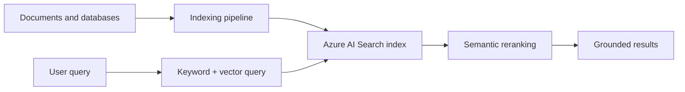

## Architecture


## Index design
Store searchable text, vector fields, stable document identifiers, source URI, timestamps, content type and security principals. Chunk by semantic structure rather than fixed character count alone.

## Hybrid query pseudo-example
```json
{
  "search": "how to restore a deleted vault",
  "vectorQueries": [{
    "kind": "vector",
    "vector": [0.01, -0.08, 0.12],
    "fields": "contentVector",
    "k": 50
  }],
  "filter": "allowedGroups/any(g: g eq 'group-object-id')",
  "top": 8
}
```

## Workarounds
- **Relevant document ranks low:** combine keyword and vector search, tune field weights and use semantic reranking.
- **Index has duplicate chunks:** create deterministic chunk IDs and idempotent ingestion.
- **ACL filter is too large:** use group/object identifiers and resolve membership efficiently.
- **Vector dimensions mismatch:** embedding model and index vector field must match.
- **Indexer skips files:** inspect indexer status, parsing mode, supported type and skill execution errors.

## 2024 attention points
Vector search was not a replacement for filters, metadata and keyword relevance. Hybrid retrieval was generally more robust for enterprise content.

## Production validation checklist
- [ ] Confirm regional availability, SKU, API version and 2024 feature status against Microsoft documentation.
- [ ] Review current retirement notices before reusing the article after 2024.
- [ ] Test in a non-production subscription and preserve rollback evidence.
- [ ] Validate identity, DNS, network, cost, monitoring, security and recovery dependencies.
- [ ] Replace placeholders and never paste production secrets into source control.
- [ ] Use architecture decision records for material trade-offs.

> **Historical scope:** This article is written with a 2024 architecture lens. It describes real Azure services and engineering patterns, but Azure capabilities evolve. Revalidate all commands, limits, SKUs, API versions and support status before production use.
