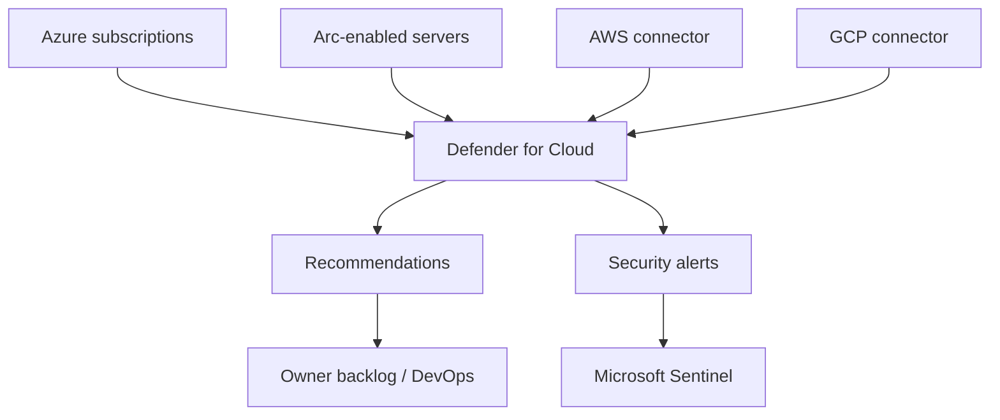

## Architecture

## Operating model
Separate posture recommendations from active threat alerts. Assign owners, due dates and exceptions. Use regulatory standards as views, not as proof that every business risk is controlled.

## Workarounds
- **Secure score rises without material risk reduction:** prioritise internet exposure, privilege, data sensitivity and exploitability rather than score points alone.
- **Agent or extension deployment fails:** validate Arc/Azure agent health, proxy and policy remediation identity.
- **Recommendation cannot be fixed immediately:** create a documented exemption with compensating control and expiry.
- **Duplicate alerts in Sentinel:** define connector and analytics ownership to prevent duplicate incidents.

## 2024 attention points
Cloud security posture management increasingly covered multi-cloud and DevOps context. Organisations needed consistent asset ownership to convert recommendations into engineering work.

## Production validation checklist
- [ ] Confirm regional availability, SKU, API version and 2024 feature status against Microsoft documentation.
- [ ] Review current retirement notices before reusing the article after 2024.
- [ ] Test in a non-production subscription and preserve rollback evidence.
- [ ] Validate identity, DNS, network, cost, monitoring, security and recovery dependencies.
- [ ] Replace placeholders and never paste production secrets into source control.
- [ ] Use architecture decision records for material trade-offs.

> **Historical scope:** This article is written with a 2024 architecture lens. It describes real Azure services and engineering patterns, but Azure capabilities evolve. Revalidate all commands, limits, SKUs, API versions and support status before production use.
