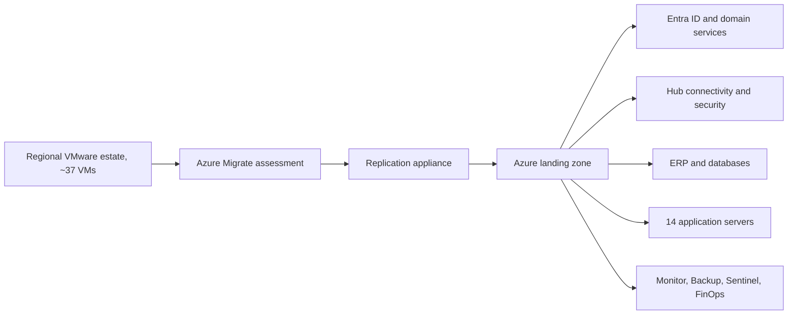

## Executive summary
A regional site operated approximately **37 virtual machines** on VMware. A partial VMware licence renewal was expected to cost around **€100,000**, creating a decision point: renew the existing stack or use the event to migrate to Microsoft Azure.

The selected approach was not a blind one-to-one conversion. Plan A mapped on-premises CPU and memory directly to Azure and produced unnecessary cost. Plan B selected the closest Azure SKU that met workload requirements and became the basis for the target estimate.

The migration programme was structured over approximately **13 weeks**: two weeks of Azure Migrate discovery, one week of cleanup, a pilot of **two to three VMs**, infrastructure and domain services, ERP and databases, **14 application servers**, then cutover and transition to managed RUN.

## Business drivers
- avoid approximately €100k of VMware renewal expenditure;
- eliminate local VPN, firewall and DR single points of failure;
- align identity with Microsoft Entra ID and Conditional Access;
- integrate Microsoft Sentinel and Zero Trust controls;
- use Azure-native backup, monitoring and FinOps;
- create a supported operating model rather than sustain ageing local infrastructure.

## Architecture


## Sizing approach
A 1:1 mapping preserves source allocation rather than actual demand. The optimised plan used workload requirements and available metrics to select Azure SKUs.

Examples in the sizing set ranged from roughly **€88.58/month** for small D-series Windows VMs to about **€1,272.57/month** for a 12-vCPU Oracle Linux workload. Individual examples are not reusable prices because Azure region, licences, storage, reservations and price date all matter.

### Assessment data
```powershell
Get-CimInstance Win32_ComputerSystem | Select-Object Manufacturer,Model,TotalPhysicalMemory
Get-CimInstance Win32_OperatingSystem | Select-Object Caption,Version,LastBootUpTime
Get-CimInstance Win32_LogicalDisk | Select-Object DeviceID,Size,FreeSpace
Get-CimInstance Win32_Service | Select-Object Name,State,StartMode,StartName
Get-NetTCPConnection | Export-Csv .\connections.csv -NoTypeInformation
```

### Azure Migrate data to validate
- CPU and memory history;
- boot type and disk layout;
- OS support status;
- network dependencies;
- database throughput;
- peak periods;
- vendor support;
- required availability model;
- target region capacity.

## Wave plan
| Phase | Indicative timing | Outcome |
|---|---|---|
| Discovery | weeks 1–2 | sizing, dependencies, landing-zone readiness |
| Cleanup | weeks 2–3 | remove snapshots and resolve blockers |
| Pilot | weeks 3–4 | 2–3 low-risk VMs tested |
| Wave 1 | weeks 4–6 | infrastructure and domain services |
| Wave 2 | weeks 6–10 | ERP and databases |
| Wave 3 | weeks 10–12 | 14 application servers |
| Cutover | weeks 12–13 | Go/No-Go, migration, validation |
| BAU | ongoing | monitoring, backup, security and FinOps |

## Pilot acceptance criteria
- replication remains healthy;
- target VM boots and required services start;
- DNS and domain authentication work;
- backup and monitoring are active;
- application owner validates functionality;
- performance remains within agreed range;
- rollback is tested or rehearsed;
- incident and change records contain evidence.

## Go/No-Go pack
```text
Replication status
Latest consistent recovery point
Target-region capacity and quota
DNS, routes, NSGs and firewall changes
Service accounts and certificates
Vendor availability
Final backup confirmation
Technical test script
Business validation owners
Rollback deadline and data reconciliation method
```

## Financial interpretation
The €100k licence avoidance was a strong first-year driver but did not by itself prove positive ROI. The business case also had to include:

- Azure monthly compute and storage;
- pay-as-you-go versus reservation scenarios;
- data transfer and backup;
- migration non-recurring cost;
- dual-running period;
- application-vendor work;
- operating-model impact;
- residual on-premises costs;
- avoided hardware and support risk.

The proposal treated Azure BAU as part of an existing managed-service model rather than a new local operations team. That operating-model assumption was as important as the infrastructure price.

## Workarounds and risks
- **VMware renewal deadline is too close:** prioritise pilot and workloads with the clearest dependency map, and establish a contingency renewal decision date.
- **Legacy OS blocks migration:** agree upgrade, extended security or isolated exception before cutover.
- **ERP vendor cannot validate:** separate the ERP wave and require vendor attendance.
- **Source VM is overallocated:** select the Azure size from utilisation and application requirements, not source configuration.
- **IP address continuity is requested:** challenge hard-coded IP dependencies and use DNS where possible.
- **Database requires more RAM than selected SKU:** validate database-specific sizing separately from generic VM logic.

## Business value
The programme used an unavoidable licence decision to modernise availability, security and operations. The migration reduced dependence on a local technology stack, created a repeatable cloud operating model and avoided renewing infrastructure that no longer matched the target strategy.

## Publication and confidentiality note
This article is based on an enterprise engagement. Customer names, internal identifiers, hostnames, subscription identifiers, commercial contacts and selected architecture details have been removed or normalised. Quantified values are retained only where they are useful to explain the engineering or business decision. Prices remain indicative and must be recalculated before reuse.
