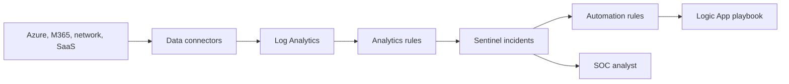

## Architecture


## Data-first design
Before enabling every connector, define detection use cases, retention, ingestion volume, ownership and response. A connector without a detection or investigation use case creates cost without outcome.

## KQL example
```kusto
SigninLogs
| where TimeGenerated > ago(1h)
| where ResultType != 0
| summarize Failures=count(), Countries=dcount(LocationDetails.countryOrRegion)
  by UserPrincipalName, bin(TimeGenerated, 15m)
| where Failures > 10 or Countries > 2
```

## Workarounds
- **Analytics rule is noisy:** tune entity, threshold, lookback and suppression using incident evidence.
- **Playbook cannot access incident:** give the managed identity minimum Sentinel and target-system permissions.
- **Connector stopped silently:** alert on data freshness and expected event volume.
- **KQL consumes resources:** filter early and avoid unbounded joins.
- **MITRE mapping becomes cosmetic:** tie each rule to response steps, data source and test evidence.

## 2024 attention points
Content Hub solutions simplified packaging, but teams still needed version control and regression testing for local rule changes.

## Production validation checklist
- [ ] Confirm regional availability, SKU, API version and 2024 feature status against Microsoft documentation.
- [ ] Review current retirement notices before reusing the article after 2024.
- [ ] Test in a non-production subscription and preserve rollback evidence.
- [ ] Validate identity, DNS, network, cost, monitoring, security and recovery dependencies.
- [ ] Replace placeholders and never paste production secrets into source control.
- [ ] Use architecture decision records for material trade-offs.

> **Historical scope:** This article is written with a 2024 architecture lens. It describes real Azure services and engineering patterns, but Azure capabilities evolve. Revalidate all commands, limits, SKUs, API versions and support status before production use.
