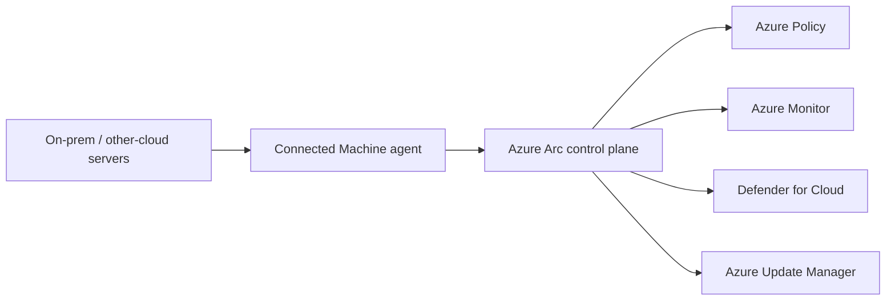

## Architecture

## Operating boundaries
Arc projects supported server metadata and selected Azure management capabilities onto non-Azure machines. Arc did not move the workload into Azure or replace the local hypervisor and network operations.

## Onboarding
Use service principal or supported scalable onboarding with least privilege, then transition ongoing extensions to managed identity where supported. Tag server owner, environment, location and criticality.

## Workarounds
- **Server shows disconnected:** check agent service, proxy, TLS inspection and required endpoints.
- **Extension deployment loops:** inspect local agent logs and extension handler state before retrying.
- **Policy remediation is inconsistent:** confirm machine scope, extension prerequisites and managed identity.
- **Duplicate server objects after rebuild:** define lifecycle and resource naming to avoid stale Arc resources.

## 2024 attention points
Arc adoption often failed when there was no ownership model for disconnected agents, extensions and policy remediation.

## Production validation checklist
- [ ] Confirm regional availability, SKU, API version and 2024 feature status against Microsoft documentation.
- [ ] Review current retirement notices before reusing the article after 2024.
- [ ] Test in a non-production subscription and preserve rollback evidence.
- [ ] Validate identity, DNS, network, cost, monitoring, security and recovery dependencies.
- [ ] Replace placeholders and never paste production secrets into source control.
- [ ] Use architecture decision records for material trade-offs.

> **Historical scope:** This article is written with a 2024 architecture lens. It describes real Azure services and engineering patterns, but Azure capabilities evolve. Revalidate all commands, limits, SKUs, API versions and support status before production use.
