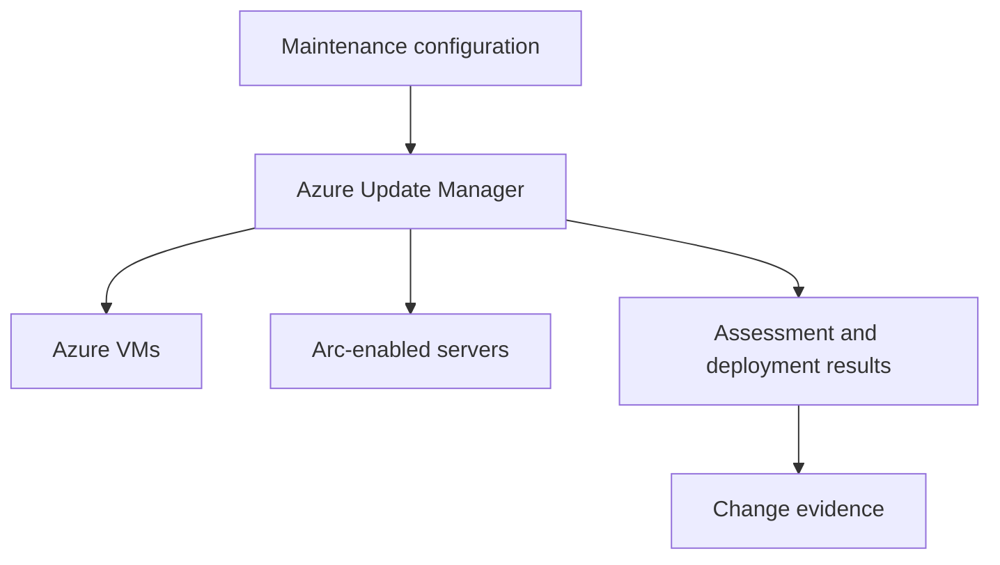

## Architecture


## Patch rings
Create rings based on criticality and application dependency:

```text
Ring 0: lab/canary
Ring 1: non-production
Ring 2: low-risk production
Ring 3: critical production
```

Separate OS patch success from application-validation success. Include load balancer drain, service stop/start and smoke tests.

## Workarounds
- **Assessment reports missing patches after deployment:** check reboot state, supersedence and assessment refresh.
- **Maintenance window is too short:** measure download, installation and reboot time; pre-stage where supported.
- **Arc machine does not patch:** validate connected agent, extension and network access.
- **Clustered app loses quorum:** patch one failure domain at a time and integrate application-aware orchestration.

## 2024 attention points
Azure Update Manager replaced earlier Azure Automation Update Management patterns. Migration required recreating schedules, scopes, reporting and operational runbooks, not just enabling a new blade.

## Production validation checklist
- [ ] Confirm regional availability, SKU, API version and 2024 feature status against Microsoft documentation.
- [ ] Review current retirement notices before reusing the article after 2024.
- [ ] Test in a non-production subscription and preserve rollback evidence.
- [ ] Validate identity, DNS, network, cost, monitoring, security and recovery dependencies.
- [ ] Replace placeholders and never paste production secrets into source control.
- [ ] Use architecture decision records for material trade-offs.

> **Historical scope:** This article is written with a 2024 architecture lens. It describes real Azure services and engineering patterns, but Azure capabilities evolve. Revalidate all commands, limits, SKUs, API versions and support status before production use.
