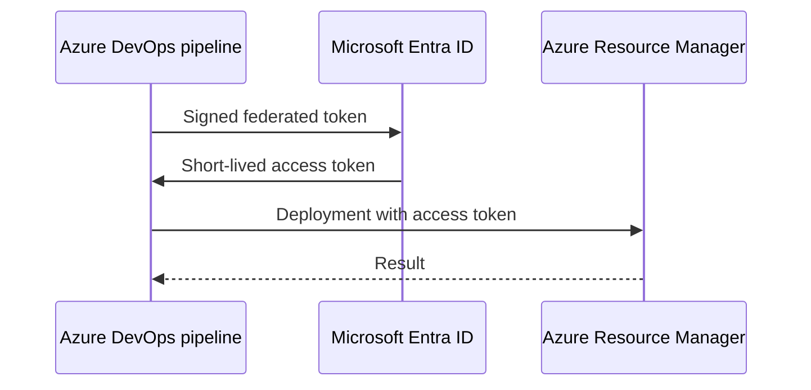

## Architecture


## Why it matters
A traditional service connection with a client secret creates rotation and leakage risk. Workload identity federation exchanges trusted pipeline identity for a short-lived token without a stored client secret.

## Pipeline example
```yaml
steps:
- task: AzureCLI@2
  inputs:
    azureSubscription: sc-prod-federated
    scriptType: bash
    scriptLocation: inlineScript
    inlineScript: |
      az account show
      az deployment sub what-if         --location westeurope         --template-file infra/main.bicep         --parameters infra/prod.bicepparam
```

## Workarounds
- **Federated credential subject mismatch:** recreate or correct issuer, subject and audience exactly.
- **Pipeline authenticates but deployment fails:** authentication succeeded, but Azure RBAC is missing at target scope.
- **One connection has excessive rights:** use separate connections by environment and deployment boundary.
- **Pull request can deploy production:** protect environments with approvals, branch policies and pipeline permissions.

## 2024 attention points
2024 was a key adoption period for replacing long-lived Azure DevOps service-connection secrets with federation.

## Production validation checklist
- [ ] Confirm regional availability, SKU, API version and 2024 feature status against Microsoft documentation.
- [ ] Review current retirement notices before reusing the article after 2024.
- [ ] Test in a non-production subscription and preserve rollback evidence.
- [ ] Validate identity, DNS, network, cost, monitoring, security and recovery dependencies.
- [ ] Replace placeholders and never paste production secrets into source control.
- [ ] Use architecture decision records for material trade-offs.

> **Historical scope:** This article is written with a 2024 architecture lens. It describes real Azure services and engineering patterns, but Azure capabilities evolve. Revalidate all commands, limits, SKUs, API versions and support status before production use.
