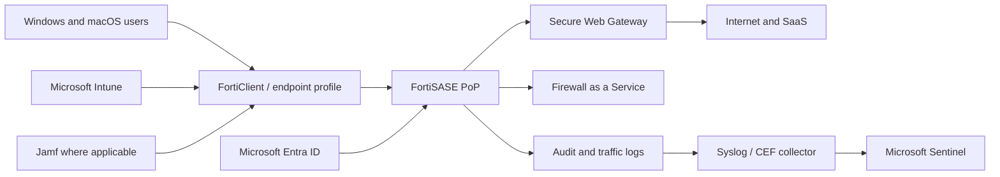

## Executive summary
A global retail organisation needed consistent internet security for users working inside and outside corporate locations. The scope targeted approximately **2,000 users**, about **167 shops and remote/head-office locations**, managed Windows and macOS devices, and selected POS devices subject to compatibility validation.

The programme focused on Secure Web Gateway and Firewall-as-a-Service. It did not replace the existing VPN and did not assume every site would be migrated into SASE networking. Site traffic continued through the existing firewall model, while selected end-user devices gained a cloud-delivered security control.

A controlled **50-user pilot** was chosen to test identity, endpoint deployment, traffic steering, TLS inspection, policy enforcement, performance, logging and rollback before production conversion. A commercial reconciliation was also required between approximately **1,800 licences** and roughly **2,000 planned users or endpoints**.

## Architecture


## Programme phases
```text
Assessment and HLD
→ LLD and tenant configuration
→ technical build testing
→ controlled 50-user pilot
→ formal acceptance
→ production conversion
→ rollout waves to ~2,000 users
→ hypercare
→ operational handover and RUN
```

## Why a pilot was mandatory
The pilot tested interactions that could not be proven from documentation alone:

- SAML/RADIUS/LDAP identity integration;
- Windows and macOS client profiles;
- endpoint posture tags;
- reachability to FortiSASE PoPs;
- SWG category filtering;
- FWaaS rules;
- TLS inspection and certificate trust;
- SaaS compatibility;
- remote-user performance;
- China-specific or regional connectivity constraints;
- endpoint packaging and rollback through Intune;
- log export and investigation.

## Pilot population
The 50 users had to be representative rather than convenient. The cohort should include:

```text
Head-office users
Remote workers
Multiple countries/regions
Windows and macOS
Business-critical SaaS
High-bandwidth and latency-sensitive users
Support and security testers
At least one fallback cohort outside the pilot
```

## Test matrix
| Test | Expected result |
|---|---|
| Entra authentication | user signs in with correct group and policy |
| Intune deployment | client installed without manual admin action |
| Internet steering | approved traffic reaches correct PoP |
| Category filtering | block/allow rules match policy |
| TLS inspection | trusted applications work, exceptions documented |
| FWaaS | agreed ports and destinations enforced |
| Unreachable PoP | approved fail-open or fail-closed behaviour occurs |
| Client rollback | prior state restored within support window |
| Logging | user, device, policy and action visible end to end |
| Performance | latency and user experience remain acceptable |

## The fail-open decision
Fail-open was not an engineering preference. It was a business risk decision.

```text
Fail open  → productivity preserved, security control bypassed
Fail closed → security enforcement preserved, user productivity may stop
```

The decision required Security, Business and Workplace approval, named exceptions and monitoring.

## TLS inspection
TLS inspection added a complete certificate lifecycle:

- trusted root distribution;
- macOS and Windows validation;
- browser and native application compatibility;
- privacy and regulatory exclusions;
- certificate pinning exceptions;
- break/fix ownership;
- emergency bypass policy;
- renewal monitoring.

It could not be treated as a simple checkbox in the portal.

## RACI and supplier boundaries
The technology vendor provisioned the SaaS platform, PoPs and vendor guidance. The implementation team converted business requirements into HLD/LLD, identity integration, policy and tests. Workplace teams owned Intune packaging and endpoint targeting. Network teams owned routing and firewall prerequisites. Security approved policy and exceptions. The RUN team required administration rights, knowledge and a defined service catalogue before handover.

Attendance at a PoC did not make the technology vendor accountable for end-to-end integration or UAT. Likewise, an integrator could not own endpoint rollout without access and authority in Intune.

## Licence and user reconciliation
A difference between 1,800 licences and 2,000 target users/endpoints could create a hidden rollout blocker. The resolution required:

- count unique users versus devices;
- confirm shared POS or technical accounts;
- define inactive-user handling;
- confirm licence assignment behaviour;
- reserve pilot and support licences;
- align procurement before production conversion.

## Logging architecture
When no native SIEM connector satisfied requirements, Syslog or CEF could be forwarded through a collector. The design had to define:

- collector ownership;
- inbound source restrictions;
- TLS transport;
- certificate and secret rotation;
- parsing and normalisation;
- buffer/retry behaviour;
- Sentinel ingestion and retention cost;
- alert rules and responsible SOC team.

## Production rollout
A safe rollout did not enrol 2,000 users in one step. Example wave model:

```text
Wave 0: technical users
Wave 1: 50-user pilot
Wave 2: one region and low-risk population
Wave 3: major head office
Wave 4: remaining regions
Wave 5: exceptional endpoints and validated POS scope
```

Each wave had pass/fail criteria, support staffing, freeze windows and rollback.

## Business value
- consistent user-level policy outside active VPN sessions;
- stronger threat and web-category controls;
- central visibility across remote users;
- reduced dependence on network location;
- evidence for security investigations;
- structured move from implementation to managed support.

## Workarounds and failure modes
- If agent coexistence is a blocker, use a controlled explicit-proxy pattern where scope permits.
- If native apps bypass browser proxy, do not claim full-device protection.
- If certificate pinning breaks apps, implement reviewed exclusions rather than disabling inspection globally.
- If PoP routing adds latency, validate region selection and ISP path.
- If rollout produces excessive tickets, pause at the wave gate and correct packaging, policy or support knowledge.
- If the vendor PoC entitlement is shorter than the planned pilot, reconcile timeline and acceptance before starting.

## Publication and confidentiality note
This article is based on an enterprise engagement. Customer names, internal identifiers, hostnames, subscription identifiers, commercial contacts and selected architecture details have been removed or normalised. Quantified values are retained only where they are useful to explain the engineering or business decision. Prices remain indicative and must be recalculated before reuse.
