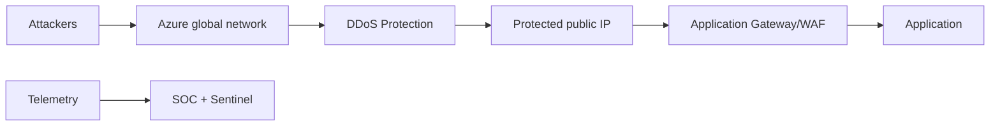

## Architecture

## Layered defence
DDoS protection addresses volumetric network attacks. WAF addresses many HTTP attack patterns. Application resilience, autoscaling and rate limiting remain separate responsibilities.

## Readiness
Inventory public IPs, business criticality, DNS, WAF, alert contacts and response process. Create metric alerts for packets, SYN packets and attack state where available.

## Workarounds
- **Only the edge is protected:** origin public IP can still be attacked if exposed. Restrict origin access.
- **Autoscaling multiplies cost during attack:** define scaling limits and upstream throttling.
- **Alert generates no action:** integrate notification, incident ownership and provider escalation procedure.
- **Test traffic looks like attack:** use authorised testing processes and approved partners; never perform uncontrolled stress testing.

## 2024 attention points
Teams needed to distinguish contractual DDoS cost protection, service tier coverage and architecture requirements rather than assuming all public IPs had identical protection.

## Production validation checklist
- [ ] Confirm regional availability, SKU, API version and 2024 feature status against Microsoft documentation.
- [ ] Review current retirement notices before reusing the article after 2024.
- [ ] Test in a non-production subscription and preserve rollback evidence.
- [ ] Validate identity, DNS, network, cost, monitoring, security and recovery dependencies.
- [ ] Replace placeholders and never paste production secrets into source control.
- [ ] Use architecture decision records for material trade-offs.

> **Historical scope:** This article is written with a 2024 architecture lens. It describes real Azure services and engineering patterns, but Azure capabilities evolve. Revalidate all commands, limits, SKUs, API versions and support status before production use.
