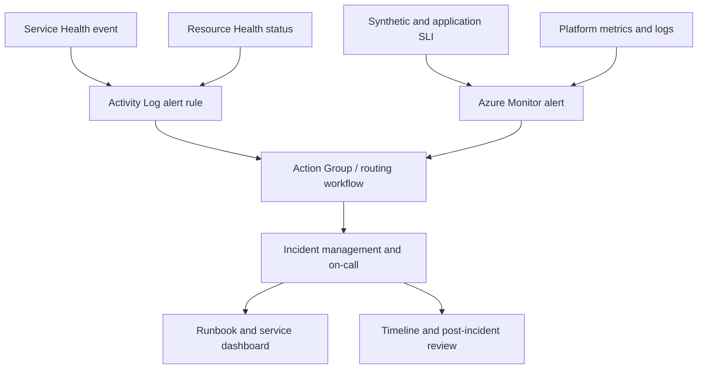

> **Updated 13 November 2026.** Service Health alerts and Resource Health alerts are separate alert types with different scopes and signals. Test both paths and validate notification delivery before relying on them during an incident.

An Azure outage is rarely diagnosed from a single status page. A cloud platform may report an incident affecting a region, while an individual resource remains available; a resource may become unavailable without a broad service incident; and an application can fail while Azure reports no platform issue. An incident-ready operations design combines cloud-provider health signals with workload telemetry, dependency checks, and a rehearsed response process.

Azure provides three related but distinct views: Azure Status, Azure Service Health, and Azure Resource Health. Azure Status is a global view of widely affecting incidents. Service Health is personalized to a tenant or subscription and reports relevant service issues, planned maintenance, health advisories, and security advisories. Resource Health reports the health of individual supported resources and can provide platform or user-initiated context. Microsoft's [Service Health overview](https://learn.microsoft.com/azure/service-health/overview) describes how the three experiences fit together.

## 1. Understand the three health signals

### Azure Status: broad, public incidents

The public Azure Status page presents a global view of Azure service and region health. It is useful for situational awareness and broad incidents, but it is not a complete inventory of events relevant to a specific subscription. Use it as a reference during investigation, not as the only monitor for a production estate.

### Service Health: personalized provider communication

Azure Service Health provides notifications relevant to the subscriptions, services, regions, and tenant directories in scope. It covers service issues, planned maintenance, health advisories, and security advisories. The Azure portal experience can show impacted services and resources, updates, mitigation guidance, and related event information.

Service Health answers, “Has Microsoft published an event that may affect services or regions I use?” It does not establish that a particular application is down. A service event can list resources as potentially impacted before their own health changes, or it can affect a service dependency while the application remains healthy.

### Resource Health: status of an individual resource

Resource Health is a resource-level signal. It reports statuses such as Available, Degraded, Unavailable, and Unknown for supported resource types. The details may identify a platform-initiated event, a planned event, or a user-initiated action. The checks differ by resource provider and resource type, so do not assume every resource exposes the same level of health detail.

`Unknown` is not equivalent to `Unavailable`. It means Azure does not currently have health information for that resource; it can occur when the resource stops sending signals or is deallocated. It is an operational uncertainty that should be correlated with workload monitoring. Microsoft describes the statuses and their interpretation in the [Resource Health overview](https://learn.microsoft.com/azure/service-health/resource-health-overview) and [Resource Health FAQ](https://learn.microsoft.com/azure/service-health/resource-health-faq).

A fourth signal is still required: **workload health**. Application synthetic checks, service-level indicators, queue processing, database connectivity, and end-to-end transactions tell you whether users can complete the business task. Azure provider health cannot replace those checks.

| Signal | Scope | Best use | What it cannot prove |
|---|---|---|---|
| Azure Status | Global Azure services and regions | Broad incident awareness | Whether your subscription or resource is impacted |
| Service Health | Tenant/subscription and selected service/region | Provider events and planned changes relevant to your estate | Whether a specific customer journey is failing |
| Resource Health | Individual supported resource | Resource-specific platform or user action context | Full application or dependency health |
| Workload telemetry | Application/service behavior | User impact, SLOs, and business transaction health | Whether Azure has published an underlying platform event |

## 2. Create alert rules for provider events

Service Health notifications are written to the Azure Activity Log. To receive notifications automatically, create Service Health alert rules and associate action groups. A portal alert rule can filter on affected subscription or tenant, service, region, and event type. Microsoft lists the event types as service issues, planned maintenance, health advisories, and security advisories. The [Create Service Health alerts guide](https://learn.microsoft.com/azure/service-health/alerts-activity-log-service-notifications-portal) documents the current configuration.

For enterprise coverage, Microsoft recommends selecting all services and regions when creating a Service Health rule. The service only triggers notifications for events relevant to the selected subscriptions and regions where the services run; selecting all avoids silently excluding an affected service because the rule's filter was too narrow. This advice does not mean every event should page every engineer. Keep broad event capture, then route by event type, service ownership, severity, and operational role.

A useful minimum set of rules separates response urgency:

- **Service issues:** notify the central incident channel and on-call operations team; page only when the event or workload telemetry indicates customer impact that requires action.
- **Planned maintenance:** notify service owners early enough to review redundancy, failover behavior, and change windows.
- **Health advisories:** route to the platform or service owner for assessment and due-date tracking.
- **Security advisories:** route to the security operations function and affected service owners using the organization's security incident process.

Event semantics and available filters may change. Review the current alert rule configuration during platform onboarding and after significant changes to subscriptions, regions, or Azure services.

### Action group region and delivery

Service Health alert rules can only be created in the Global region, and Microsoft documents that an associated action group must also use the Global region for Service Health alerts to function correctly. This requirement is easy to miss when action groups are created for regional metric alerts. Confirm the action group region and test the delivery path.

Action groups can notify email recipients, SMS, Azure mobile app, webhooks, Logic Apps, and ITSM integrations, depending on the configured action type and service support. Select channels based on urgency and operational ownership. Email can be useful for planned maintenance; a verified on-call integration is more appropriate for urgent service-impacting events.

Do not treat successful alert-rule creation as proof that notifications work. Test action group receivers and the event-processing workflow. Some health alert workflows support a test action or payload; otherwise exercise the receiving Logic App or webhook with a representative sample and validate parsing, routing, and deduplication. Keep the rule's scope, filters, action group, receiver ownership, and last test date in an operational inventory.

## 3. Alert on individual resource health separately

Resource Health alerts are resource-scoped or can target a supported group of resources. They can detect status transitions even when Azure has not published a wider service incident. Typical conditions include:

- current resource status becomes Unavailable;
- resource status changes to Degraded;
- status changes from Unavailable to Available, for recovery tracking;
- event state changes to Resolved;
- the event reason indicates a platform-initiated or user-initiated action.

Use status transitions to distinguish an outage from a recovery notification. A condition on “current status equals Available” alone may not tell you whether the resource just recovered or has been healthy for months. Pair previous and current status, event status, and reason type where the alert rule supports them.

Resource Health alerts use Activity Log alerting and action groups. Create them for critical resources or service groups, then ensure newly created resources are included where appropriate. Scope is important: an alert that covers only the current resource group can miss future resource groups unless the rule is configured to include them. Microsoft's [Resource Health alert guide](https://learn.microsoft.com/azure/service-health/resource-health-alert-monitor-guide) and [creation guidance](https://learn.microsoft.com/azure/service-health/resource-health-alert-arm-template-guide) explain the relevant conditions and scope.

Some resource types do not provide the same health data or support the same conditions. Validate the [supported resource types and health checks](https://learn.microsoft.com/azure/service-health/resource-health-overview) for the actual resources in the service. Where Resource Health is not available or lacks sufficient detail, use application-level checks and Azure Monitor metrics or logs.

## 4. Build layered incident detection

A resilient detection architecture uses independent signals at different levels:

The Service Health alert says that a provider event might matter. The Resource Health alert says that a specific resource's health has changed. The application alert says that an SLI or customer journey is failing. The incident workflow correlates them using time, region, service dependencies, resource IDs, and deployment history.

Keep an application health check independent of the same resource signal being monitored. For example, a VM health status can be Available while the web process is dead or DNS is misconfigured. A synthetic transaction from a separate network path can test user-visible behavior and reveal this gap. Likewise, a synthetic check can fail because a test identity expired while the service is healthy; the incident workflow needs context to tell the difference.

Define alert severity by action, not by the source event's label alone. A Service Health event marked important may require a change review but not an immediate page. Conversely, a small resource-level issue can require urgent action if it affects a critical business service. Map alerts to a service catalogue and escalation policy that accounts for workload criticality, redundancy, and user impact.

## 5. Route events by ownership and impact

A central operations team needs visibility across subscriptions, but workload owners need actionable notifications about their service. Use an ownership catalogue that maps subscription, resource group, resource tags, service, region, and on-call rotation. Keep the mapping in source control or an authoritative service registry and test it when subscriptions or services move.

A routing workflow can:

1. Receive an alert payload through an action group.
2. Normalize event type, subscription, region, service, tracking ID, impacted resources, and event status.
3. Resolve affected services and owners from the inventory.
4. Deduplicate notifications using the provider's event or tracking identifier and status.
5. Create or update an incident or change record.
6. Attach runbook, dashboard, and known dependency links.
7. Update or close the record when the event is resolved.

Use the Common Alert Schema when supported by the alert type and receiver. It can provide a normalized envelope across alert sources, but the `alertContext` for Activity Log events still contains source-specific fields. Test against real or representative payloads and tolerate missing optional values. Do not parse only a human-readable email subject; use stable IDs and structured fields where available. See Microsoft's [Common Alert Schema documentation](https://learn.microsoft.com/azure/azure-monitor/alerts/alerts-common-schema).

Event streams can deliver updates as the provider changes its assessment. Treat an event as a lifecycle: active, updated, mitigated, or resolved where the payload exposes those states. Do not create a new incident for every update. Preserve the raw payload or a secure reference to it for audit and post-incident review, while applying the organization's retention and access policies.

## 6. Plan for planned maintenance and advisories

Planned maintenance is an opportunity to validate resilience before an emergency. When an event affects a resource or region:

- identify the workloads and dependent resources in scope;
- check whether redundancy spans the affected failure domain;
- validate backup, failover, and data replication state;
- determine if the workload needs customer communication;
- confirm who can approve a failover or maintenance action;
- monitor after the event for secondary effects.

Do not automatically fail over every service in response to a planned event. A failover can create data divergence, capacity pressure in another region, or a longer outage than staying in place. Use a documented decision matrix that accounts for expected impact, health probes, recovery objectives, and service owner approval.

Health advisories and security advisories often require engineering action rather than incident response. Route them to a backlog with a due date and a risk owner. A security advisory should follow the organization's security process even if there is no active resource health degradation. Track whether a recommended action is complete and attach the evidence.

## 7. Correlate provider events with application telemetry

Create a shared incident timeline using timestamps from Service Health, Resource Health, Azure Monitor, deployment systems, and application logs. Pay attention to time zones and the difference between event creation time, last update time, and the time the alert was delivered. A notification can arrive after the provider event began; detection and delivery latency should be measured separately.

During an incident, use this sequence:

1. **Confirm customer impact.** Review synthetic checks, SLI dashboards, and support reports.
2. **Check provider context.** Review Service Health for relevant events and impacted-resource details.
3. **Inspect resource state.** Review Resource Health for affected resources and platform/user reason.
4. **Check recent changes.** Correlate deployments, policy changes, network changes, and operator actions.
5. **Map dependencies.** Determine whether an upstream service, DNS, identity, network route, or shared platform is involved.
6. **Choose a recovery action.** Follow the workload runbook and recovery objective; do not assume the provider event alone dictates failover.
7. **Communicate and update.** Assign an incident commander and provide a single status channel for responders and stakeholders.

Service Health provides information about provider events, not complete application diagnostics. If the app is unhealthy but no provider event exists, continue investigating configuration, code, quota, capacity, data, and identity. Conversely, if Azure marks the resource Available, that does not invalidate a customer-impacting application alert.

## 8. Permissions, scope, and multi-subscription deployment

Alert-rule creation requires permissions to read the target scope, write the alert rule in its resource group, and read associated action groups. Use a controlled platform identity or deployment pipeline to create rules at scale. Avoid giving every subscription contributor the ability to change the global on-call action group.

For large estates, define deployment at the management-group or subscription baseline level where the API and alert type support it. Service Health alert rules are Activity Log alerts and have scope semantics different from a metric alert. Verify how tenant-level events, subscription scope, and future subscriptions are handled. A rule deployed to today's subscriptions may not automatically cover subscriptions created next month unless the organization has an onboarding control.

Use infrastructure as code or a deployment pipeline to manage consistent rules, action groups, tags, and routing. Keep secrets out of templates. Use parameterized lists for critical services and regions, but consider Microsoft's guidance to select all services and regions for Service Health rule coverage. If you apply tighter filters for routing, ensure an unfiltered central capture path still exists so new or overlooked services are not silently excluded.

Monitor for rule drift: deleted alert rules, changed action groups, disabled receivers, expired webhook credentials, and action group region changes. Report expected versus actual coverage as part of platform compliance.

## 9. Test alert behavior and recovery

An alerting design is incomplete until the notification and response path has been exercised. Test:

- the action group receiver and escalation rotation;
- Service Health event routing for each relevant event type;
- Resource Health alert conditions for outage, degradation, and recovery;
- the webhook or Logic App parser with missing optional fields;
- deduplication of event updates;
- incident creation, ownership resolution, and closure;
- behavior when the primary incident platform is unavailable;
- subscription onboarding and future resource coverage.

Not every Azure platform event can be safely generated on demand. Use supported alert test features where available, test action groups directly, and replay a sanitized representative payload into a non-production receiver. Label the test clearly so it does not trigger a production incident. Preserve evidence of the test and repeat it after receiver, action group, or routing changes.

For high-criticality workloads, run a tabletop exercise using a realistic Service Health event and a separate Resource Health event. Ask responders to identify the affected services, check application SLOs, decide whether to fail over, and communicate status. The exercise often reveals missing owner data or runbooks more effectively than another alert rule.

## 10. Troubleshoot missing or noisy notifications

| Symptom | Common cause | Checks |
|---|---|---|
| Azure event appears in portal but no alert arrives | No matching rule or a filter excludes the service/region/event type | Rule scope, services, regions, event types, enabled state |
| Alert fires but no receiver gets it | Action group or receiver configuration issue | Action group region is Global, receiver validation, delivery logs |
| Event appears for a subscription not expected | Scope or tenant selection is broader than the routing logic | Rule scope, subscription mapping, tenant-level rules |
| Resource is unhealthy but no Resource Health alert | Resource type unsupported or condition does not match transition | Supported resource health checks, event status, current/previous state |
| Health status is Unknown | Resource Health lacks current signal, resource deallocated, or provider data delayed | Resource state, timestamps, workload probes and monitoring |
| Duplicate incidents for one outage | Event updates not deduplicated | Tracking ID/event ID, lifecycle state, incident correlation key |
| An app is down while Azure health says Available | Application, guest OS, network, dependency, or configuration issue | Synthetic test, app logs, metrics, DNS, identity, recent deployment |
| All alerts arrive late | Receiver processing or subscription routing delay | Compare event timestamp, alert fired time, delivery time, workflow latency |
| Planned maintenance is missed | Rule filters, subscription onboarding, or action group delivery failure | Scope coverage, test evidence, event type and region selections |

Do not respond to missing health data by assuming the service is healthy. Correlate Unknown with application monitoring and resource state. If the provider health feed is delayed, maintain the workload incident process and update the timeline when the provider event becomes available.

## 11. Operational metrics and service objectives

Measure the quality of the health-alerting system itself:

- percentage of production subscriptions with Service Health alert coverage;
- percentage of critical resource classes with Resource Health rules where supported;
- action group test success rate;
- alert delivery latency from provider event to receiver;
- percentage of events mapped to a service owner;
- duplicate incident rate and false-positive rate;
- time to acknowledge, mitigate, and resolve incidents;
- number of stale runbooks or unowned action groups.

These are coverage and response measures, not Azure availability measures. Pair them with application SLOs and business-impact indicators. A green Service Health dashboard does not demonstrate that users can complete transactions, and a high rule-coverage percentage does not guarantee the action group is deliverable.

For each critical workload, define a user-centric SLI such as successful request ratio, transaction completion, queue processing delay, or data freshness. Use Service Health and Resource Health as context for diagnosing SLO burn, not as the SLO itself. During incident review, note whether the Azure signal arrived, whether it was actionable, and whether the service's own telemetry detected impact first.

## 12. A practical deployment pattern

**Foundation:** create a global operations action group and a central Service Health rule for the relevant tenant/subscriptions. Select the event types and scope according to Microsoft guidance. Assign a central team to monitor broad events.

**Workload layer:** deploy Resource Health rules for critical resource types and scopes where supported. Include future resources when the service model and rule configuration allow it. Route each resource alert through the service ownership catalogue.

**Application layer:** deploy synthetic probes and SLO alerts independently of Azure health signals. Link them to workload dashboards and runbooks.

**Integration layer:** normalize alert payloads, deduplicate by event identity, enrich with ownership and dependency data, create or update incidents, and preserve lifecycle updates.

**Validation:** test action groups, replay sanitized payloads, confirm subscription onboarding, and run a tabletop exercise. Review coverage after changes to the management-group hierarchy or incident platform.

## Production readiness checklist

- [ ] Teams understand the different roles of Azure Status, Service Health, Resource Health, and workload monitoring.
- [ ] Service Health alert rules cover the required subscriptions, services, regions, and event types.
- [ ] Resource Health alerts cover critical supported resources and status transitions.
- [ ] Service Health rule and associated action group use the required Global region.
- [ ] Action group recipients, webhooks, and ITSM integrations have been tested.
- [ ] Alerts route to a service owner and on-call function with a documented escalation policy.
- [ ] Event updates are deduplicated and lifecycle changes update the same incident.
- [ ] Workload SLOs and synthetic checks operate independently of Azure health signals.
- [ ] New subscriptions and resources are included through an onboarding control.
- [ ] Unknown health states trigger investigation rather than being reported as healthy.
- [ ] Runbooks define failover decisions, communication, recovery, and evidence preservation.
- [ ] Coverage, delivery latency, ownership resolution, and incident outcomes are reviewed regularly.

## References

- [Azure Service Health overview](https://learn.microsoft.com/azure/service-health/overview)
- [Azure Status overview](https://learn.microsoft.com/azure/service-health/azure-status-overview)
- [Create Service Health alerts](https://learn.microsoft.com/azure/service-health/alerts-activity-log-service-notifications-portal)
- [Resource Health overview](https://learn.microsoft.com/azure/service-health/resource-health-overview)
- [Resource Health alerts](https://learn.microsoft.com/azure/service-health/resource-health-alert-monitor-guide)
- [Create a Resource Health alert](https://learn.microsoft.com/azure/service-health/resource-health-alert-arm-template-guide)
- [Impacted resources from Service Health events](https://learn.microsoft.com/azure/service-health/impacted-resources-outage)
- [Common Alert Schema](https://learn.microsoft.com/azure/azure-monitor/alerts/alerts-common-schema)
- [Service Health FAQ](https://learn.microsoft.com/azure/service-health/service-health-faq)
