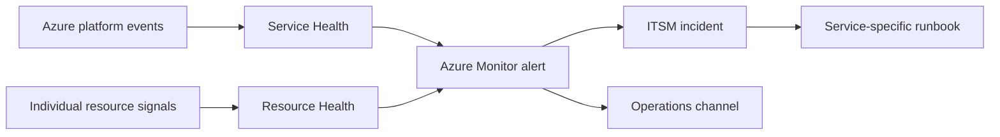

## Architecture


## Distinguish the signals
Service Health covers service incidents, planned maintenance and advisories relevant to subscriptions. Resource Health focuses on individual resource availability. Neither replaces application monitoring.

## Alert automation
```bash
az monitor activity-log alert create   --name service-health-alert   --resource-group rg-monitoring   --scope /subscriptions/<subscription-id>   --condition category=ServiceHealth   --action-group <action-group-id>
```

## Workarounds
- **No one sees advisory:** route to an owned action group and ITSM queue, not a personal email.
- **Many duplicate tickets:** centralise subscription alerts and deduplicate on tracking ID and event type.
- **Platform says healthy but users fail:** use synthetic probes and application telemetry.
- **Maintenance notification lacks owner:** map subscriptions and services to accountable application teams.

## 2024 attention points
Operational maturity meant converting Azure notices into dependency-aware impact assessment and communication, not forwarding emails.

## Production validation checklist
- [ ] Confirm regional availability, SKU, API version and 2024 feature status against Microsoft documentation.
- [ ] Review current retirement notices before reusing the article after 2024.
- [ ] Test in a non-production subscription and preserve rollback evidence.
- [ ] Validate identity, DNS, network, cost, monitoring, security and recovery dependencies.
- [ ] Replace placeholders and never paste production secrets into source control.
- [ ] Use architecture decision records for material trade-offs.

> **Historical scope:** This article is written with a 2024 architecture lens. It describes real Azure services and engineering patterns, but Azure capabilities evolve. Revalidate all commands, limits, SKUs, API versions and support status before production use.
