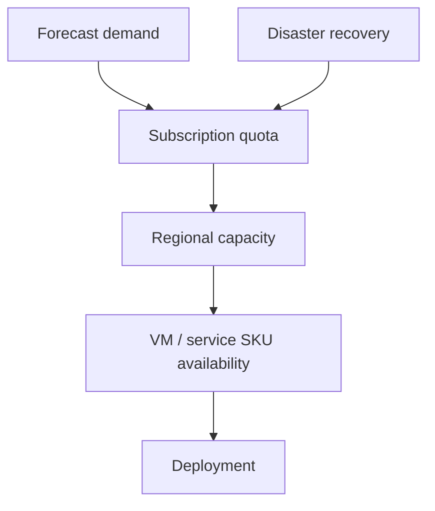

## Architecture


## Two different constraints
Quota authorises how much a subscription can consume. Capacity determines whether the region or zone can supply a specific SKU at that moment. A quota increase does not reserve capacity.

## Inventory
```bash
az vm list-usage --location westeurope -o table
az vm list-skus --location westeurope --resource-type virtualMachines --all -o table
```

## Workarounds
- **DR region has quota but deployment fails:** validate SKU capacity and maintain approved alternatives.
- **Scale set cannot add nodes:** inspect family quota, regional capacity, subnet IPs and placement constraints.
- **Quota request is late:** forecast baseline plus surge and submit before migration or seasonal peak.
- **One SKU is hard-coded:** parameterise approved SKU families and validate performance differences.

## 2024 attention points
Capacity planning became more important for GPU, high-memory and popular VM families. Recovery plans needed quota and alternative-SKU decisions before an incident.

## Production validation checklist
- [ ] Confirm regional availability, SKU, API version and 2024 feature status against Microsoft documentation.
- [ ] Review current retirement notices before reusing the article after 2024.
- [ ] Test in a non-production subscription and preserve rollback evidence.
- [ ] Validate identity, DNS, network, cost, monitoring, security and recovery dependencies.
- [ ] Replace placeholders and never paste production secrets into source control.
- [ ] Use architecture decision records for material trade-offs.

> **Historical scope:** This article is written with a 2024 architecture lens. It describes real Azure services and engineering patterns, but Azure capabilities evolve. Revalidate all commands, limits, SKUs, API versions and support status before production use.
