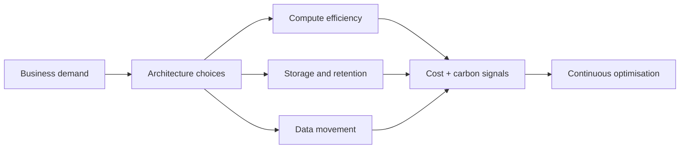

## Architecture lens

## Practical engineering actions
- remove unused resources;
- scale to demand;
- choose efficient managed services where appropriate;
- compress data when benefit exceeds CPU overhead;
- use storage tiers aligned with access frequency;
- reduce unnecessary data replication and transfer;
- optimise database queries and retention;
- schedule non-production workloads.

## Workarounds
- **Archive tier reduces carbon but harms recovery:** sustainability does not override RTO and legal retention.
- **Compression raises CPU:** measure end-to-end energy, latency and bandwidth trade-off.
- **Region choice conflicts with residency:** compliance and user latency remain constraints.
- **Carbon metric becomes vanity score:** tie actions to measurable utilisation, data volume and service outcome.

## 2024 attention points
GreenOps was most credible when integrated with FinOps and efficiency engineering rather than treated as a separate reporting exercise.

## Production validation checklist
- [ ] Confirm regional availability, SKU, API version and 2024 feature status against Microsoft documentation.
- [ ] Review current retirement notices before reusing the article after 2024.
- [ ] Test in a non-production subscription and preserve rollback evidence.
- [ ] Validate identity, DNS, network, cost, monitoring, security and recovery dependencies.
- [ ] Replace placeholders and never paste production secrets into source control.
- [ ] Use architecture decision records for material trade-offs.

> **Historical scope:** This article is written with a 2024 architecture lens. It describes real Azure services and engineering patterns, but Azure capabilities evolve. Revalidate all commands, limits, SKUs, API versions and support status before production use.
