## Executive summary
An enterprise had already invested in Zscaler Digital Experience telemetry but needed to operationalise it through the service desk. The objective was not to add another monitoring console. It was to create a controlled operating model in which selected ZDX alerts generated enriched ServiceNow incidents, routed work to the correct support group, enabled short guided L1 diagnosis and provided deeper L2 evidence.

The initial recommendation was deliberately bounded: **five to eight high-value alert rules**, group-level assignment, deterministic correlation, human validation and no autonomous remediation or automatic incident closure during the pilot.

The implementation roadmap used three phases:

```text
Frame & Connect: use cases, RACI, ServiceNow and KPI baseline
Pilot & Learn: targeted alerts, L1/L2 runbooks and weekly review
Industrialise & Scale: automation, dashboards and Problem Management
```

## Architecture

```mermaid
flowchart LR
    Agents[ZDX agents and probes] --> Cloud[ZDX cloud]
    Cloud --> Rules[Approved alert rules]
    Rules --> Webhook[Authenticated HTTPS webhook]
    Webhook --> SN[ServiceNow integration]
    SN --> Validate[Validation and transformation]
    Validate --> Correlate[Correlation and deduplication]
    Correlate --> Incident[Create or update incident]
    Incident --> Route[Assignment rules / Flow Designer]
    Route --> L1[L1 guided triage]
    L1 --> L2[L2 deep tracing and RCA]
    L2 --> Problem[Problem and knowledge]
    Problem --> Tune[Threshold and runbook tuning]
    Tune --> Rules
```


## Why ServiceNow remained the entry point
Broad ZDX access for every L1 analyst would have increased licensing, training and process complexity. The integration instead enriched ServiceNow with enough context to act:

- experience score and trend;
- affected service;
- location or department;
- impacted users and devices;
- alert start and recovery state;
- ZPA, application, network or device domain;
- stable correlation ID;
- controlled link to deeper evidence.

## Direct incident versus Event Management
### Direct Incident Management
Best for a curated pilot where each approved alert should become an actionable ticket. It provides the shortest path to value.

### Event Management
Best when ServiceNow ITOM Event Management already acts as the enterprise event layer and must correlate many sources before incident creation.

The decision depended on source volume, ITOM maturity, speed-to-value requirement and cross-tool correlation need.

## Correlation model
A stable correlation key was essential:

```text
alert-rule + device-or-service + location + active-time-window
```

Processing behaviour:

```text
New qualifying alert   → create incident
Repeated active alert  → update existing incident
Recovery notification  → update recovery fields, do not auto-close
Malformed payload      → reject/quarantine and alert integration support
Unknown mapping        → route to fallback triage queue
```

## Payload example
```json
{
  "source": "zdx",
  "event_id": "evt-12345",
  "rule_id": "saas-latency-global",
  "status": "active",
  "observed_at": "2024-10-25T08:30:00Z",
  "domain": "application",
  "service": "collaboration-service",
  "location": "site-code",
  "device_id": "pseudonymised-device",
  "experience_score": 42,
  "severity": "medium",
  "evidence_url": "https://monitoring.example/event/evt-12345"
}
```

## Use-case catalogue
The pilot focused on support situations where telemetry could change the L1 decision:

1. widespread SaaS degradation;
2. single-user application degradation;
3. endpoint CPU or memory pressure;
4. Wi-Fi or network-path deterioration;
5. ZPA path or connector issue;
6. site-level performance degradation;
7. recurring device degradation.

## L1 runbook
A practical L1 interaction needed to fit within **five to seven minutes**:

```text
1. Open ServiceNow incident.
2. Confirm user/device/service and impact.
3. Read ZDX score, location and alert evidence.
4. Check device health, network path, ZPA and application state.
5. Apply approved action or route with evidence.
6. Record outcome and false-positive reason where relevant.
```

## Test plan
| ID | Scenario | Expected result |
|---|---|---|
| T01 | valid new alert | one incident with mandatory fields |
| T02 | repeated alert | existing incident updated, no duplicate |
| T03 | recovered alert | incident updated, not auto-closed |
| T04 | device issue | Workplace group selected |
| T05 | network/site issue | Network group with location context |
| T06 | ZPA issue | security/network group selected |
| T07 | known application | mapped to application service owner |
| T08 | unknown mapping | fallback queue and visible flag |
| T09 | malformed payload | rejected or quarantined with diagnostics |
| T10 | invalid credentials | no record, integration alert generated |
| T11 | ServiceNow outage | bounded retries, no duplicate storm after recovery |

## KPI framework
- webhook success rate;
- processing latency;
- valid assignment rate;
- fallback rate;
- duplicate-prevention rate;
- actionable-alert rate;
- proactive detection rate;
- MTTA and MTTR versus baseline;
- false-positive rate;
- recurring problems removed;
- experience trend by service and location.

Possible pilot thresholds should be agreed, not assumed. A useful initial target set might be 99% webhook delivery, more than 90% valid assignment and less than 10% false positives, but these remain pilot acceptance targets until measured.

## Security design
- dedicated least-privilege integration identity;
- authenticated HTTPS webhook;
- restricted source and endpoint where technically possible;
- separate non-production and production credentials;
- no unnecessary personal data in payload;
- secret rotation and vault ownership;
- audit trail for mapping and assignment changes;
- controlled deep-tracing roles.

## Operational resilience
The integration needed retry with exponential backoff, dead-letter or quarantine handling, delivery dashboards and a fallback queue. ServiceNow downtime could not result in an uncontrolled flood of duplicate records after recovery.

## Business value
- detects selected incidents before end-user contact;
- shortens diagnosis by delivering evidence with the incident;
- improves assignment accuracy;
- reduces repeated generic troubleshooting;
- turns recurring telemetry into Problem Management;
- measures digital experience by service and location;
- reuses the existing ZDX investment rather than adding another platform.

## Failure modes and workarounds
- Too many alerts: narrow pilot rules and require owner/runbook before ticket creation.
- Weak CMDB mapping: route by explicit service/location mapping and improve the CMDB iteratively.
- L1 access limitation: enrich the incident rather than granting broad console access.
- Duplicate incidents: stabilise correlation key and lifecycle rules.
- Automatic closure hides impact: retain human validation in the pilot.
- No proactive capacity in service desk: create a dedicated back-office or continual-improvement allocation.

## Publication and confidentiality note
This article is based on an enterprise engagement. Customer names, internal identifiers, hostnames, subscription identifiers, commercial contacts and selected architecture details have been removed or normalised. Quantified values are retained only where they are useful to explain the engineering or business decision. Prices remain indicative and must be recalculated before reuse.
