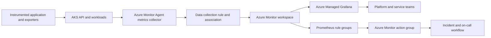

> **Updated 13 November 2026.** This guide focuses on the managed Azure Monitor service for Prometheus and Azure Managed Grafana. Confirm regional availability, pricing, limits, and preview status in the linked Microsoft documentation before adopting a specific feature.

Prometheus is a good fit for Kubernetes because its data model represents measurements as time series, its query language is expressive, and a broad ecosystem already exposes metrics in the Prometheus format. Operating a reliable metrics platform, however, is more than installing a scraper. A production design must decide which targets to collect, how to control series growth, where metrics are stored, who can query them, how alerts reach an accountable team, and how the service behaves when a cluster or a monitoring component is unavailable.

Azure Monitor managed service for Prometheus moves storage, query, and service operations into Azure. Azure Monitor Agent (AMA) collects supported cluster metrics and sends them to an Azure Monitor workspace. Azure Managed Grafana can query that workspace and combine the resulting time series with Azure Monitor metrics, logs, and other data sources. This removes much of the self-hosted Prometheus storage and upgrade burden, while leaving workload instrumentation, metric quality, alert design, access control, and cost governance as engineering responsibilities. [Microsoft's Prometheus overview](https://learn.microsoft.com/azure/azure-monitor/metrics/prometheus-metrics-overview) describes the service boundary and supported analysis paths.

## 1. Start with operational questions, not dashboards

A dashboard is useful only when it helps someone make a decision. Before onboarding clusters, write down the questions the service must answer:

- Is the customer-facing service available, and is its error rate increasing?
- Which dependency or cluster is contributing to latency?
- Is the workload saturated, or is it simply receiving a traffic spike?
- Is a deployment responsible for a change in behavior?
- Can the responder distinguish an application failure from a monitoring pipeline failure?
- Which team owns the alert, and what action should they take?

Separate **symptoms**, **causes**, and **capacity signals**. A page should usually represent a user-visible symptom or an urgent failure mode. CPU utilization, queue depth, pod restarts, and node pressure are diagnostic signals; they should not each produce an urgent page by default. A useful initial service-level view includes request volume, error ratio, latency distribution, and saturation. A platform view then provides the cluster, node, namespace, and workload context needed to investigate those symptoms.

Define ownership before installing agents. Every cluster should have an environment, service owner, technical owner, and criticality. Use stable labels such as `cluster`, `namespace`, `service`, and `environment`; avoid personal names and identifiers that change every deployment. This metadata becomes the join key between metrics, deployment records, incident ownership, and cost allocation.

## 2. Reference architecture and service boundaries

A common topology looks like this:



The **AKS cluster** hosts applications and exporters. Applications expose instrumentation in a Prometheus-compatible format, typically on an HTTP metrics endpoint. Collectors discover or are configured to scrape eligible targets. With the managed Azure path, AMA and the metrics add-on perform collection for supported Kubernetes targets. A **data collection rule (DCR)** and its association connect the collection configuration to the destination **Azure Monitor workspace**. The workspace stores Prometheus metrics and provides a query endpoint. Grafana reads from the workspace; it is a visualization and exploration layer, not the source of truth for the measurements.

This separation is useful during incident analysis. If a panel is blank, the problem may be in instrumentation, target discovery, scrape configuration, collector health, DCR association, workspace selection, identity, or the query. Treat each hop as an independently observable dependency. A green Grafana health check alone does not prove that a particular application target is being scraped.

The Azure Monitor workspace is specific to Prometheus metrics. It is distinct from a Log Analytics workspace, which stores logs and supports Kusto Query Language (KQL). Do not send every metric as a log merely because a team already has a Log Analytics workspace. Metrics and logs have different schemas, query semantics, retention behavior, and cost meters. Use logs for detailed event records and diagnostic context; use metrics for numerical measurements that must be aggregated over time. Azure's [data collection overview](https://learn.microsoft.com/azure/azure-monitor/data-collection/data-collection-overview) explains the collection model, while the [Prometheus overview](https://learn.microsoft.com/azure/azure-monitor/metrics/prometheus-metrics-overview) explains the workspace and query paths.

### Decide how many workspaces to use

A single workspace simplifies cross-cluster queries and shared dashboards. It also creates a larger shared failure, access, and governance boundary. Multiple workspaces can support regional separation, different operating teams, data residency requirements, or isolated production and non-production data. They add workspace administration and can make fleet-wide queries harder.

Choose a workspace boundary based on a real requirement: region, data ownership, security boundary, or scale. Avoid one workspace per cluster by default if the operations team needs fleet-wide views. Conversely, do not centralize every environment into one workspace if broad query access would expose data across trust boundaries. Record the reason for each boundary and establish the expected workspace count before onboarding dozens of clusters.

## 3. Instrumentation and metric contracts

Prometheus collection cannot compensate for weak instrumentation. Establish a metric contract for each service:

1. **Name metrics for what they measure.** Use unit-aware names such as `http_request_duration_seconds` and `queue_messages_ready`.
2. **Choose metric types deliberately.** Counters increase monotonically and are analyzed with functions such as `rate`; gauges can rise or fall; histograms represent distributions through bucket counters.
3. **Document labels.** State what each label means, which values are allowed, and whether it can grow with user or request volume.
4. **Keep dimensions bounded.** Labels such as `method`, `route_template`, `status_class`, and `region` are usually safer than raw URL, customer ID, request ID, or exception text.
5. **Expose an authenticated and network-scoped endpoint where appropriate.** A metrics endpoint should not become an unintended public API.
6. **Test behavior during rollout.** Renaming a metric or label can break dashboards and alerts even when the application remains healthy.

Prefer route templates over raw request paths. `/orders/{orderId}` describes a bounded route; `/orders/9f...` may create one distinct label value per request. Likewise, use a controlled error class instead of embedding exception messages. High-cardinality labels multiply the number of time series, increase ingestion and query work, and can make a workspace harder to operate. Microsoft's [Azure Monitor workspace scaling guidance](https://learn.microsoft.com/azure/azure-monitor/metrics/azure-monitor-workspace-scaling-best-practice) specifically recommends tuning scrape intervals and removing unnecessary labels from high-cardinality metrics.

Agree on naming and units across services. If one service reports latency in milliseconds and another in seconds, a shared dashboard can silently mislead its readers. Histograms should use buckets appropriate to the service's latency objectives. A histogram with buckets that are too coarse cannot answer a fine-grained latency question; excessively detailed buckets increase series volume. Keep a small metric catalogue with metric name, type, unit, owner, labels, expected collection frequency, and intended dashboard or alert.

## 4. Enable collection in controlled stages

For an AKS rollout, begin with a non-production cluster that exercises the same Kubernetes version, network model, and workload conventions as production. Enable Azure Monitor managed Prometheus through the supported Azure onboarding path, choose the destination Azure Monitor workspace, and review the generated DCR association and installed monitoring components. Do not assume an extension was installed correctly just because the portal accepted the deployment request.

Validate the pipeline from source to query:

- Confirm the metrics collector pods are healthy and have no sustained scrape or remote-write errors.
- Check that expected targets are discovered and that their scrape state is healthy.
- Query a known built-in cluster metric and one application metric.
- Confirm the `cluster` label matches the name used in dashboards and rule configuration.
- Compare a known counter or gauge with the application's own telemetry for the same interval.
- Check that the data appears in the intended Azure Monitor workspace, not a similarly named workspace.
- Confirm a Grafana identity can query the workspace and that the correct data source is selected.

Azure provides a default set of targets and metrics. Start with the default collection profile and add metrics only where an operational question requires them. The default configuration has a minimal ingestion profile to reduce unnecessary volume. If you disable that profile or enable every target, ingestion can increase substantially. The [default Prometheus metrics configuration](https://learn.microsoft.com/azure/azure-monitor/containers/prometheus-metrics-scrape-default) documents the default target model and minimal ingestion behavior.

For customization, Azure supports a ConfigMap for default target and interval settings, and custom scrape jobs using Kubernetes custom resource definitions (CRDs) such as PodMonitor and ServiceMonitor. Use one approach consistently for a cluster and keep configuration in version control. The [ConfigMap guide](https://learn.microsoft.com/azure/azure-monitor/containers/prometheus-metrics-scrape-configuration) and [CRD scrape guide](https://learn.microsoft.com/azure/azure-monitor/containers/prometheus-metrics-scrape-crd) cover the supported configuration surfaces. Test changes in a non-production cluster because schema and collector behavior can evolve.

A minimal settings fragment can be useful for discussion, but treat it as an example of intent rather than a complete replacement ConfigMap:

```yaml
# Illustrative settings only. Merge into the supported ConfigMap schema
# for the AKS and Azure Monitor add-on versions you operate.
cluster-metrics:
  minimal-ingestion-profile:
    enabled: true
  default-targets-scrape-interval-settings:
    kubelet: "30s"
    coredns: "60s"
```

The supported ConfigMap uses string-valued sections and a defined schema; validate the actual format in the Microsoft Learn guide before applying a file. Start with the default interval. Increase the interval only for signals whose operational use does not require finer granularity. A longer scrape interval lowers collection volume but can hide short-lived events and delay alert evaluation. Do not change every target to a one-second interval to make a dashboard appear more responsive; the service has ingestion limits, and high-frequency collection has a direct cost and capacity impact.

## 5. Control cardinality and ingestion before the bill arrives

Prometheus cost is strongly shaped by how many samples are ingested and how much query work is performed. A rough series-count model is:

```text
series per metric ≈ product of the distinct values of each label
samples per day ≈ active series × (86,400 / scrape interval in seconds)
```

This is only an estimate: target churn, missing samples, histogram buckets, and scrape failures change the real volume. It is still useful in design reviews. If an HTTP metric has 8 methods, 30 route templates, 6 status classes, 4 regions, and 20 pods, the potential label combinations can grow quickly. Add a request ID with thousands of unique values and the series count becomes operationally unsafe.

Use a repeatable control loop:

1. Establish a baseline by cluster, namespace, job, metric name, and label set.
2. Identify the metrics and labels that contribute the most series or samples.
3. Ask the service owner which question each high-volume metric answers.
4. Remove irrelevant targets, labels, or duplicate collection paths.
5. Adjust the scrape interval when the signal's decision window allows it.
6. Compare usage and dashboard quality after the change.

Avoid scraping an exporter both through a broad pod-annotation rule and a dedicated ServiceMonitor unless duplicate collection is intended. Do not ingest every metric exposed by a vendor exporter without understanding its labels. For application instrumentation, add label allowlists or relabeling rules where supported, and reject unbounded values during code review. Maintain a short exception process for a team that needs a temporarily high-cardinality diagnostic metric; make the owner, expiry, and expected sample volume explicit.

Pricing changes over time. At the time of this update, Azure's published model for managed Prometheus is based on ingested data samples and query samples processed, with Prometheus data retained for up to 18 months without a separate storage charge. Confirm the current meter details and regional prices in the [Azure Monitor cost documentation](https://learn.microsoft.com/azure/azure-monitor/usage-estimated-costs) and the [service overview](https://learn.microsoft.com/azure/azure-monitor/metrics/prometheus-metrics-overview) before estimating a production budget. A long retention period does not make high-volume collection free: ingestion and query activity remain material cost drivers.

Create a monthly review that correlates workspace usage with changes in cluster count, scrape configuration, and application releases. A sudden increase is often a label or target-discovery change rather than a growth in legitimate operational demand. Define a cost owner for each workspace and set a threshold for investigating unusual sample growth.

## 6. Write PromQL that answers a specific question

Consider an HTTP request counter named `http_requests_total` with bounded labels `service`, `route`, and `status_class`. A simple error ratio over five minutes is:

```promql
sum(rate(http_requests_total{status_class=~"5xx"}[5m]))
/
sum(rate(http_requests_total[5m]))
```

The numerator and denominator must describe the same population. If some services emit the counter only for completed requests, document that behavior. Use a stable label such as `status_class`; raw status text or exception descriptions can create needless dimensions. Guard dashboards against a zero denominator and distinguish “no traffic” from “zero errors.”

For a histogram called `http_request_duration_seconds`, a 95th percentile query may look like:

```promql
histogram_quantile(
  0.95,
  sum by (le, service, route) (
    rate(http_request_duration_seconds_bucket[5m])
  )
)
```

The `le` bucket label must remain in the aggregation for `histogram_quantile` to work. The result is only as useful as the histogram's bucket design and sample volume. A p95 computed from a small number of requests can be noisy; show request volume alongside latency and choose a window consistent with the service's traffic.

A node CPU utilization query can combine idle CPU time across cores, but cluster exporters and metric names differ. Verify the actual metric contract from the cluster before adopting a copied query. Never paste a dashboard query into a production alert without checking labels, empty-result behavior, rate window, and expected traffic pattern.

For fleet dashboards, provide variables for `cluster`, `namespace`, and `service`, but set defaults that show a meaningful scope. A dashboard that loads every series across every cluster by default can be slow and expensive. Use recording rules for frequently repeated aggregations, and keep ad hoc exploratory queries bounded by time range and scope. Microsoft's [Prometheus rule group documentation](https://learn.microsoft.com/azure/azure-monitor/metrics/prometheus-rule-groups) describes how managed rule groups can hold alert and recording rules.

## 7. Design alerts around user impact and ownership

A good alert has a condition, an evaluation window, a severity, an owner, an action, and a runbook. Start with user-impacting symptoms such as sustained elevated error ratio, severe latency against a service objective, or a failure to process a critical queue. Use infrastructure alerts to diagnose or prevent a symptom when the infrastructure signal has a demonstrated relationship to impact.

Avoid paging on every pod restart or every brief CPU spike. Kubernetes is a reconciliation system; rescheduling and transient restarts can be normal. Page when the signal is persistent, impacts a service, or indicates imminent exhaustion. Add a `for` duration to suppress short transients where the rule engine supports it, but choose the duration from the recovery objective rather than by habit. A long `for` can delay detection; a very short value can produce noisy alerts.

Prometheus-style alert expressions can be reviewed in source control. For example, an error ratio condition might be:

```promql
(
  sum by (service) (rate(http_requests_total{status_class=~"5xx"}[5m]))
  /
  sum by (service) (rate(http_requests_total[5m]))
) > 0.03
```

This is not a production-ready threshold by itself. The service owner must decide whether 3% is meaningful, whether the service has enough requests for the ratio to be stable, how long the condition must persist, and which environment should page. A low-volume service may need a different alert model, such as absolute failures combined with a synthetic check.

Separate alert evaluation from notification delivery. The rule identifies a condition; an Azure Monitor action group or the organization's incident-management integration routes it. Test the route end to end with the actual on-call identity. Confirm whether duplicate alerts from application, cluster, and log-based monitoring are deduplicated, and make suppression behavior visible to responders. Every page should link to a dashboard, deployment context, service owner, and first diagnostic step.

Treat missing telemetry as a separate failure mode. If the collector stops reporting, a workload may look quiet rather than healthy. Add pipeline health checks for scrape targets and collection components. If a critical service has no recent samples, alert on missing data using a method supported by the chosen rule engine. Ensure the missing-data alert itself does not depend on the same broken metric path.

## 8. Build dashboards for separate audiences

Avoid a single “everything” dashboard. A practical dashboard set often includes:

- **Service overview:** request rate, error ratio, latency percentiles, availability and dependency signals.
- **Workload diagnostics:** deployment version, pod health, restarts, resource requests and limits, and application saturation.
- **Cluster health:** nodes, allocatable capacity, pressure conditions, control-plane signals where available, and system workload health.
- **Fleet view:** cluster inventory and high-level health across regions and environments.
- **Telemetry health:** scrape target status, collector health, ingestion trends, and alert pipeline checks.

Use consistent variables and dashboard naming. Include units, time windows, and a short description of how to interpret each panel. Label panels with the source metric and expected signal. A panel with “CPU = 80%” is ambiguous unless it specifies whether this is container CPU usage relative to a request, limit, node capacity, or a rate. Add links from a fleet-level panel to the relevant cluster or service dashboard.

Azure Managed Grafana supports managed identity and Microsoft Entra-based access. Assign users or groups the least-privilege Azure and Grafana roles required for their work; refine access at folders, dashboards, and data sources only where there is a genuine separation need. For the Azure Monitor workspace, grant the Grafana identity the required data-reading role at the narrowest practical scope. Microsoft's [Grafana access guide](https://learn.microsoft.com/azure/managed-grafana/how-to-manage-access-permissions-users-identities) explains Grafana roles, and its [Azure Monitor permissions guide](https://learn.microsoft.com/azure/managed-grafana/how-to-permissions) covers data-source access.

Decide whether the data source authenticates as the Grafana managed identity or as the current user. A shared managed identity is operationally simple and makes dashboards behave consistently, but users see the data allowed to that identity. Current-user authentication can enforce per-user data permissions where supported, but introduces user-specific access dependencies and can make a shared dashboard appear differently to different people. Record this decision in the data-access model.

For internet-exposed workspaces, evaluate whether public network access is necessary. Azure Managed Grafana supports private endpoints in the Standard tier, and public access can be disabled after private connectivity is established. Validate name resolution, routing, user access, and the documented SSO behavior before closing public access. See Microsoft's [private access guide](https://learn.microsoft.com/azure/managed-grafana/how-to-set-up-private-access) and [security guidance](https://learn.microsoft.com/azure/managed-grafana/secure-azure-managed-grafana).

## 9. Security and change management

Monitoring data may disclose service names, deployment topology, internal endpoints, and workload behavior. Treat it as operationally sensitive even when it contains no customer payload. Do not put secrets, tokens, personal identifiers, or raw customer data in labels. Protect dashboard editing separately from dashboard viewing, and review access when teams or contractors change.

Use managed identities where the integration supports them. Avoid long-lived client secrets in Grafana data sources. Keep role assignments at the workspace or resource-group scope required for the use case, not subscription-wide by default. For a private deployment, test both user-to-Grafana access and Grafana-to-data-source access; private access to the front end does not automatically make every data source private.

Treat collection configuration as code. Review changes to scrape targets, intervals, label transforms, and recording rules as production changes. A metrics change can affect cost, dashboards, alert reliability, and SLO calculations. Use separate review owners for platform collection settings and application instrumentation, and keep a rollback path for each.

## 10. Scale, resilience, and operational failure modes

Monitor ingestion and workspace health as first-class services. Microsoft's [technical details and limits](https://learn.microsoft.com/azure/azure-monitor/metrics/prometheus-metrics-details) describe service quotas and note that throttling can occur when ingestion limits are reached. Understand the support process for quota increases, but reduce unnecessary volume before requesting more capacity.

For larger fleets, group clusters by region, environment, and operational owner. Standardize cluster labels and dashboard variables. Limit rules to the cluster scope they need when a workspace serves many clusters; Microsoft recommends this as a scaling practice for Prometheus rule groups. Avoid a single global rule that repeatedly scans a very large fleet when a smaller per-cluster or per-service rule is sufficient.

Plan for at least these failure cases:

| Symptom | Likely layer | First checks |
|---|---|---|
| No metrics from one cluster | Collection | Collector pods, target discovery, cluster network, ConfigMap or CRD |
| Built-in metrics exist but app metrics do not | Instrumentation or scrape config | Endpoint path, port, labels, monitor object, network policy |
| Metrics exist in Azure but Grafana is blank | Query or identity | Workspace endpoint, data source, managed identity role, time range |
| Some targets disappear after rollout | Discovery and configuration | Selector labels, namespace scope, CRD state, scrape target health |
| Sudden ingestion increase | Cardinality or target expansion | New labels, duplicate scrape, broad annotations, interval changes |
| Alert evaluates but nobody receives it | Notification | Action group, routing, receiver health, suppression and ownership |
| Brief gaps during node maintenance | Collection continuity | Collector placement, cluster update, expected gap and service impact |

The service overview notes that cluster-level collection can have short gaps during node updates. Decide whether the application's reliability requirements need a second independent signal, such as synthetic availability checks or application-level telemetry outside the affected cluster. A managed metrics backend improves the service boundary; it does not make the Kubernetes collection path immune to cluster disruption.

### Troubleshoot systematically

When data is missing, test the pipeline in order rather than changing several components at once:

1. **Is the endpoint healthy?** From a permitted network location, verify that the target exposes a metrics response and does not require unexpected authentication.
2. **Is it discoverable?** Check the PodMonitor or ServiceMonitor selectors, namespace, labels, and endpoint port. For default targets, verify that the target is enabled.
3. **Is it scraped?** Inspect collector logs and target status using the documented troubleshooting procedure. Distinguish scrape errors from successful scrapes with no matching series.
4. **Is it forwarded?** Check the collector's DCR association, destination workspace, and ingestion errors.
5. **Can the workspace answer?** Query a known metric over an appropriate time range and verify labels.
6. **Can Grafana read it?** Validate the data source endpoint, authentication mode, RBAC, and selected workspace.
7. **Does the query filter it out?** Temporarily remove label matchers, widen the time range, and check whether the metric was renamed.

For cardinality incidents, first identify the new metric or label. Do not delete broad collections blindly; quantify the change, identify affected dashboards and alerts, and coordinate with the owning service team. Remove or transform the high-volume dimension, then monitor ingestion until it returns to baseline.

## 11. A production onboarding runbook

Use a phased rollout rather than enabling every cluster in one change window.

**Design phase:** identify owners, service objectives, workspace boundaries, regions, data classification, network paths, role assignments, and cost expectations. Select a representative cluster and document the intended metric contract.

**Pilot phase:** enable the managed collection path in non-production. Validate default targets, one instrumented application, dashboard access, a test alert, and the collection health path. Measure sample volume before onboarding additional exporters.

**Pre-production review:** compare query latency and dashboard behavior, test Grafana authentication from the actual operator groups, validate alert routing, and review private endpoint and DNS behavior if required. Confirm that no test labels contain high-cardinality identifiers.

**Production rollout:** onboard clusters in small groups. After each group, compare sample volume, collector errors, target health, query behavior, and alert noise with the baseline. Keep the previous monitoring path available until the new path has passed agreed acceptance criteria.

**Steady state:** review new metrics and scrape jobs through code review, track workspace usage monthly, remove stale dashboards and alerts, test contact routes periodically, and rehearse a monitoring outage. Document service ownership and escalation paths outside the dashboard itself.

An acceptance checklist:

- [ ] All in-scope clusters have a named operational owner and a stable cluster label.
- [ ] The Azure Monitor workspace boundary is documented and access-tested.
- [ ] Default collection is retained unless a measured requirement justifies a change.
- [ ] Application metrics use bounded labels and documented units.
- [ ] Scrape health, data presence, and Grafana query access are independently verified.
- [ ] Every paging rule has an owner, threshold rationale, runbook, and tested route.
- [ ] Ingestion baseline and review threshold are recorded.
- [ ] Private connectivity, identity, DNS, and role assignments are validated where applicable.
- [ ] Dashboard and rule configuration are version controlled.
- [ ] A rollback and monitoring-outage procedure has been exercised.

## 12. Design trade-offs and decision summary

Choose managed Prometheus when the organization wants PromQL-compatible metrics with Azure-managed storage and a lower operational burden for the metrics backend. Keep self-managed Prometheus where local autonomy, custom behavior, disconnected environments, or portability requirements justify operating storage and upgrades. A hybrid design can remote-write selected metrics into Azure, but it creates another path to secure and monitor; avoid sending duplicate metrics to both systems without a clear retention or continuity purpose.

Use Azure Managed Grafana when teams need a managed Grafana experience, Azure identity integration, and dashboards that combine Azure and Prometheus data. Use a self-managed Grafana instance when its plugin model, hosting constraints, or existing platform standards require it, while accepting the maintenance responsibility. Microsoft documents the managed Prometheus data-source setup and version-specific Grafana considerations in [Connect Grafana to Azure Monitor managed Prometheus](https://learn.microsoft.com/azure/azure-monitor/essentials/prometheus-grafana).

The core production principle is to manage the full signal lifecycle: instrument a useful question, collect only what the question needs, keep the series model bounded, query it at an appropriate scope, route alerts to an owner, and review both reliability and cost as the fleet changes. Managed services reduce undifferentiated operations; good observability still depends on disciplined engineering.

## References

- [Azure Monitor managed service for Prometheus overview](https://learn.microsoft.com/azure/azure-monitor/metrics/prometheus-metrics-overview)
- [Default Prometheus metrics configuration](https://learn.microsoft.com/azure/azure-monitor/containers/prometheus-metrics-scrape-default)
- [Customize Prometheus scraping with ConfigMap](https://learn.microsoft.com/azure/azure-monitor/containers/prometheus-metrics-scrape-configuration)
- [Create custom scrape jobs with CRDs](https://learn.microsoft.com/azure/azure-monitor/containers/prometheus-metrics-scrape-crd)
- [Azure Monitor workspace scaling best practices](https://learn.microsoft.com/azure/azure-monitor/metrics/azure-monitor-workspace-scaling-best-practice)
- [Prometheus rule groups](https://learn.microsoft.com/azure/azure-monitor/metrics/prometheus-rule-groups)
- [Azure Monitor cost and usage](https://learn.microsoft.com/azure/azure-monitor/usage-estimated-costs)
- [Azure Managed Grafana security](https://learn.microsoft.com/azure/managed-grafana/secure-azure-managed-grafana)
