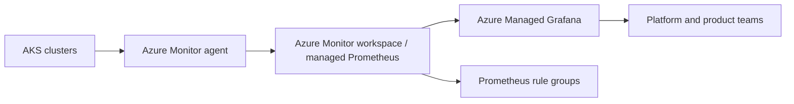

## Architecture


## Design
Use managed Prometheus for Kubernetes metrics and Managed Grafana for dashboards. Keep logs in Log Analytics according to use case. Metrics and logs have different economics and query patterns.

## PromQL example
```promql
sum(rate(http_requests_total{status=~"5.."}[5m]))
/
sum(rate(http_requests_total[5m]))
```

## Workarounds
- **Dashboard shows no data:** verify data collection rule association, scrape target and label names.
- **Cardinality explodes:** avoid unbounded labels such as user IDs or request IDs.
- **Alert works in Prometheus but not routed:** configure action delivery and ownership separately.
- **Teams cannot access dashboards:** manage Entra groups and Grafana roles, not individual assignments.

## 2024 attention points
Teams needed to govern metric cardinality early because uncontrolled labels increase cost and degrade query performance.

## Production validation checklist
- [ ] Confirm regional availability, SKU, API version and 2024 feature status against Microsoft documentation.
- [ ] Review current retirement notices before reusing the article after 2024.
- [ ] Test in a non-production subscription and preserve rollback evidence.
- [ ] Validate identity, DNS, network, cost, monitoring, security and recovery dependencies.
- [ ] Replace placeholders and never paste production secrets into source control.
- [ ] Use architecture decision records for material trade-offs.

> **Historical scope:** This article is written with a 2024 architecture lens. It describes real Azure services and engineering patterns, but Azure capabilities evolve. Revalidate all commands, limits, SKUs, API versions and support status before production use.
