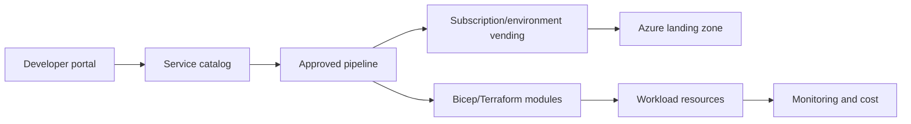

## Architecture

## Golden path
A golden path is an easy, supported route that embeds security, observability, networking and cost controls. It should be optional only when teams have an approved reason and ownership for deviation.

## Product boundaries
Treat the platform as a product with users, roadmap, service levels, telemetry and support. Measure environment lead time, deployment success, policy exceptions and developer satisfaction.

## Workarounds
- **Self-service becomes unrestricted provisioning:** expose governed products, not raw Owner access.
- **Golden path is ignored:** reduce friction and integrate with existing developer workflow.
- **Central team becomes bottleneck:** automate standard cases and reserve human review for exceptions.
- **Module updates break consumers:** version modules and publish migration guidance.

## 2024 attention points
Internal developer portals and platform engineering gained momentum, but successful programmes focused on product adoption rather than portal technology alone.

## Production validation checklist
- [ ] Confirm regional availability, SKU, API version and 2024 feature status against Microsoft documentation.
- [ ] Review current retirement notices before reusing the article after 2024.
- [ ] Test in a non-production subscription and preserve rollback evidence.
- [ ] Validate identity, DNS, network, cost, monitoring, security and recovery dependencies.
- [ ] Replace placeholders and never paste production secrets into source control.
- [ ] Use architecture decision records for material trade-offs.

> **Historical scope:** This article is written with a 2024 architecture lens. It describes real Azure services and engineering patterns, but Azure capabilities evolve. Revalidate all commands, limits, SKUs, API versions and support status before production use.
