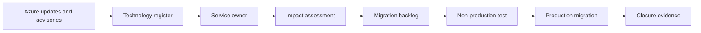

## Architecture


## Lifecycle
Maintain a register of services, API versions, SDKs, extensions, OS images and dependencies. Record retirement date, owner, impact, target version, test evidence and completion.

## Detection
Scan IaC and repositories for obsolete API versions, extensions and packages. Combine Microsoft advisories with Resource Graph inventory.

```bash
grep -R "azure-cli-ml\|Microsoft.Azure.Management\|2020-.*-preview" .
```

## Workarounds
- **Advisory has no owner:** derive owner from subscription, application tag and repository.
- **Migration is postponed repeatedly:** quantify support and outage risk, set executive deadline and block new usage.
- **Vendor dependency is incompatible:** maintain isolation, replacement or contractual escalation plan.
- **Upgrade changes behaviour:** use canary deployment and compatibility tests, not version change alone.

## 2024 attention points
Examples requiring planning included SDK generations, OS images, legacy agents and service tiers. The durable lesson was to manage retirement as portfolio governance, not emergency work.

## Production validation checklist
- [ ] Confirm regional availability, SKU, API version and 2024 feature status against Microsoft documentation.
- [ ] Review current retirement notices before reusing the article after 2024.
- [ ] Test in a non-production subscription and preserve rollback evidence.
- [ ] Validate identity, DNS, network, cost, monitoring, security and recovery dependencies.
- [ ] Replace placeholders and never paste production secrets into source control.
- [ ] Use architecture decision records for material trade-offs.

> **Historical scope:** This article is written with a 2024 architecture lens. It describes real Azure services and engineering patterns, but Azure capabilities evolve. Revalidate all commands, limits, SKUs, API versions and support status before production use.
