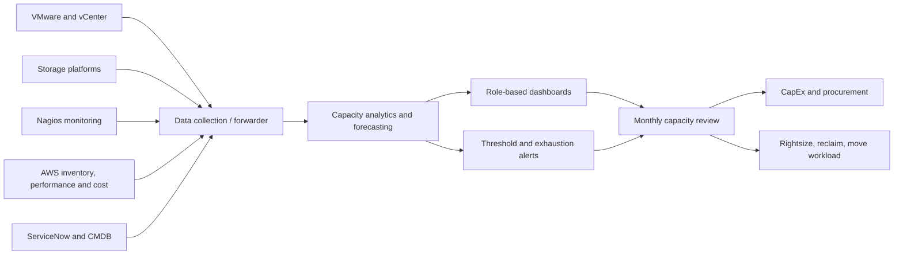

## Executive summary
A two-data-centre VMware environment comprised **26 hosts**, **694 VMs**, roughly **2,420 vCPUs**, **603 TB of total storage capacity**, **419 TB provisioned** and **374 TB used**. Analysis also highlighted **770 unused licences out of 1,558**, one cluster without HA, outdated infrastructure firmware and an absence of a standard capacity-planning process.

The business problem was timing. Hardware was often ordered only after capacity became critical, despite an approximate three-month procurement lead time. Depending on the asset, the organisation needed one, two, three or six months of warning to arrange CapEx and purchasing.

The target was a capacity-management service that consolidated VMware, storage, AWS, Nagios and ServiceNow information, produced projections and created an accountable monthly review.

## Architecture


## Estate findings
| Item | Observed value |
|---|---:|
| ESXi hosts | 26 |
| VMs | 694 |
| Total vCPU | 2,420 |
| Storage total | 603 TB |
| Storage provisioned | 419 TB |
| Storage used | 374 TB |
| Licences not used | 770 of 1,558 |

Two data centres also showed different utilisation profiles. One operated at about **28.4% average vCPU** and **38.6% average memory**, while the second was closer to **44.5% vCPU** and **47.8% memory**. The difference supported workload-balancing and forecasting discussions rather than immediate hardware purchase.

## Forecasting method
A capacity forecast needs more than a single threshold.

```text
Usable remaining capacity = physical/usable capacity - committed usage - operational reserve
Daily growth              = slope over selected historical window
Days to exhaustion        = usable remaining capacity / daily growth
Decision date              = exhaustion date - procurement lead time - deployment buffer
```

For a three-month procurement lead time and one-month engineering buffer, an alert at 30 days to exhaustion is useless. The decision threshold must occur more than 120 days before projected exhaustion.

## Forecast types
### Linear projection
Uses a stable historical trend, ideally with several months of data. Useful for storage growth with predictable behaviour.

### Recent-growth projection
Weights the latest period more heavily. Useful when demand has recently changed, but more sensitive to temporary spikes.

### Scenario modelling
Adds known business events:

```text
Baseline growth
+ approved projects
+ seasonal peak
+ migration demand
- planned decommissioning
- expected optimisation
```

## Capacity KPIs
- CPU and memory headroom by cluster;
- vCPU-to-core ratio;
- storage committed, used and free;
- datastore latency and IOPS;
- HA admission-control capacity;
- powered-off and abandoned VM count;
- snapshot age;
- licence utilisation;
- forecast exhaustion date;
- forecast confidence;
- procurement lead-time risk;
- reclaim opportunity.

## Critical risks
- one cluster had HA disabled;
- vCenter instances were not clustered;
- firmware and management-controller versions required review;
- there was no formal capacity-planning process;
- VM sprawl and resource waste were visible;
- security modernisation, including segmentation and encryption, remained part of the roadmap.

## Monthly operating model
```text
Week 1: data-quality and collector status
Week 2: platform-team validation of exceptions
Week 3: capacity review with infrastructure and service owners
Week 4: procurement, optimisation and project decisions
```

Each forecast needed an owner and action:

```text
Risk: cluster projected below 20% headroom in 150 days
Owner: infrastructure platform lead
Action: reclaim 40 vCPU, validate workload move, prepare CapEx option
Decision date: 120 days before exhaustion
Evidence: six-month trend plus approved project pipeline
```

## Standalone versus shared analytics
A standalone deployment gave stronger customer control but required several local servers and lifecycle ownership. A shared service reduced local infrastructure but introduced tenancy, network, data-residency and access decisions. The choice had to include operational support, not only software features.

## Business value
- prevents emergency hardware purchases;
- avoids capacity-related service interruption;
- identifies reclaim before CapEx;
- balances workloads across sites;
- provides evidence for budgeting;
- connects technical growth to business projects;
- makes licence waste visible;
- supports cloud-migration decisions where local expansion no longer offers value.

## Workarounds and attention points
- A forecast without six months of history should show lower confidence.
- Average utilisation hides peaks and HA reserve. Use percentiles and failure scenarios.
- Thin-provisioned storage needs both logical commitment and physical usage.
- Cloud capacity does not remove planning: quota, regional capacity and cost remain constraints.
- An unused licence count requires entitlement and assignment validation before claiming saving.
- Workload movement between sites must include latency, data gravity and DR implications.

## Publication and confidentiality note
This article is based on an enterprise engagement. Customer names, internal identifiers, hostnames, subscription identifiers, commercial contacts and selected architecture details have been removed or normalised. Quantified values are retained only where they are useful to explain the engineering or business decision. Prices remain indicative and must be recalculated before reuse.
