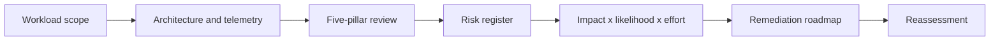

## Review model


## Five pillars
Review reliability, security, cost optimisation, operational excellence and performance efficiency. Avoid scoring from interviews alone. Require evidence such as deployment code, alerts, failover tests, cost reports, access reviews and incident records.

## Risk statement format
```text
Because <condition>, there is a risk that <event>, causing <business impact>.
Evidence: <logs, configuration, test result>.
Recommendation: <specific change>.
Owner and due date: <accountability>.
```

## Workarounds
- **Review becomes a checklist:** connect each finding to workload objective and business impact.
- **Everything is marked critical:** use defined severity criteria and dependency analysis.
- **Recommendation is generic:** specify service, scope, configuration and validation test.
- **No remediation happens:** convert findings into funded backlog with owners and dates.

## 2024 attention points
The Well-Architected Framework was most useful as a recurring engineering practice at design, pre-production and major-change gates, not as a one-time audit.

## Production validation checklist
- [ ] Confirm regional availability, SKU, API version and 2024 feature status against Microsoft documentation.
- [ ] Review current retirement notices before reusing the article after 2024.
- [ ] Test in a non-production subscription and preserve rollback evidence.
- [ ] Validate identity, DNS, network, cost, monitoring, security and recovery dependencies.
- [ ] Replace placeholders and never paste production secrets into source control.
- [ ] Use architecture decision records for material trade-offs.

> **Historical scope:** This article is written with a 2024 architecture lens. It describes real Azure services and engineering patterns, but Azure capabilities evolve. Revalidate all commands, limits, SKUs, API versions and support status before production use.
