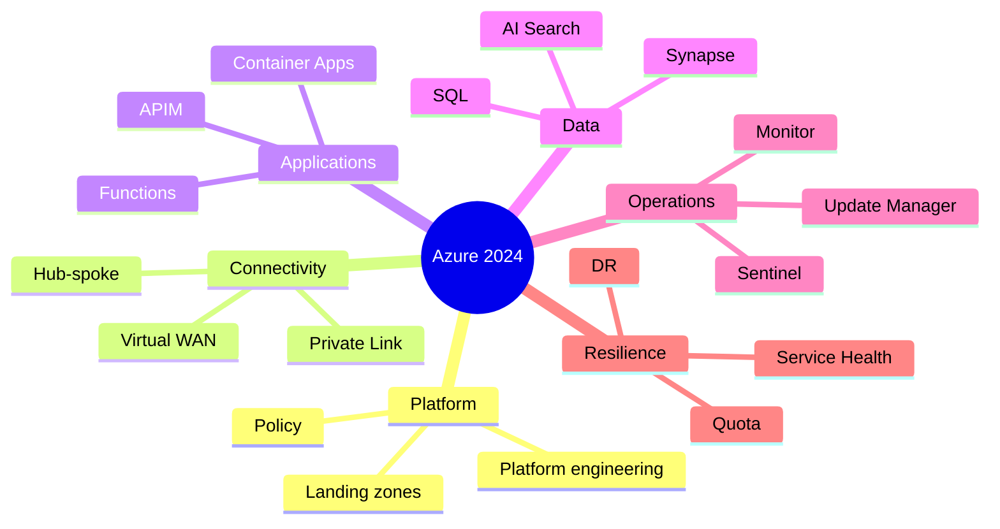

## Reference map

## The recurring lessons

1. **DNS was part of architecture.** Private endpoints, hybrid paths and disaster recovery depended on deliberate name resolution.
2. **Identity replaced secrets.** Managed identity and workload federation reduced rotation and leakage risks.
3. **Policy required rollout engineering.** Audit, remediation, exemptions and canary hierarchy were safer than immediate blanket deny.
4. **Recovery required evidence.** Backups, replicas and secondary regions mattered only when applications could be restored and validated.
5. **AI needed evaluation.** RAG quality, security trimming, prompt injection and token economics separated production from demo.
6. **Platform teams became product teams.** Golden paths and automated subscription vending increased consistency only when usable.
7. **Cost and sustainability converged around efficiency.** Rightsizing, retention, data movement and scaling reduced both waste and resource use.

## Carry-forward checklist
- protect privileged access with PIM and Conditional Access;
- eliminate long-lived deployment credentials;
- test routing, DNS and failover;
- version infrastructure and policy;
- maintain retirement and quota registers;
- measure reliability and cost per business transaction;
- require evidence for architecture reviews.

## 2024 attention points
This retrospective intentionally avoids claims about a fictional implementation. It consolidates real design concerns that Azure engineers faced across 2024 and converts them into reusable controls.

## Production validation checklist
- [ ] Confirm regional availability, SKU, API version and 2024 feature status against Microsoft documentation.
- [ ] Review current retirement notices before reusing the article after 2024.
- [ ] Test in a non-production subscription and preserve rollback evidence.
- [ ] Validate identity, DNS, network, cost, monitoring, security and recovery dependencies.
- [ ] Replace placeholders and never paste production secrets into source control.
- [ ] Use architecture decision records for material trade-offs.

> **Historical scope:** This article is written with a 2024 architecture lens. It describes real Azure services and engineering patterns, but Azure capabilities evolve. Revalidate all commands, limits, SKUs, API versions and support status before production use.
